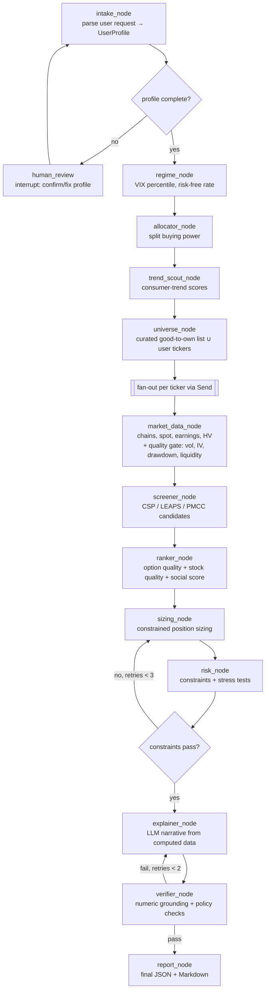

# OptionsScout AI

**Type in your buying power, pick cash-secured puts, LEAPS or both, and get option candidates on good-to-own stocks only — sized to your account, under explicit risk limits, with every number computed by tested Python and the LLM only writing the explanation.**

> Educational screening tool. Not investment, tax or legal advice. Options involve significant risk, including loss exceeding the premium received on margin. Data may be delayed or inaccurate. The app never places trades and never connects to a brokerage.

Data handling (market data, Reddit, keys, logs): [PRIVACY.md](PRIVACY.md). Licence: [MIT](LICENSE).

_Demo GIF: not recorded yet. `make demo` prints the full report in about one second; `make ui` opens the one-page app._

## How it works in one paragraph

The universe is a **curated list of ~30 good-to-own names** (large, profitable companies with long dividend records or dominant franchises, plus SPY and QQQ) in [`config/quality_universe.yaml`](config/quality_universe.yaml). On every run each ticker — including any you add — must pass a **deterministic quality gate**: price ≥ $20, average volume ≥ 1M, 30-day realised volatility ≤ 35%, implied volatility ≤ 45%, and no more than 20% below its 90-day high. Whatever fails is listed with the reason and never reaches the option screeners. Survivors get a quality score that carries 35% of the final ranking; the option's own economics carry 50% and the consumer-trend signal 15%. Buying power is split by risk profile, buckets for strategies you did not ask for are held as cash, and positions are sized greedily under six portfolio constraints with a −10/−20/−30% stress test. Prices come from bundled fixtures, Yahoo Finance (no key) or **your own Tradier API key pasted into the page** (used for that run only, never stored).

---

## Quickstart (fixture mode, no API keys)

```bash
git clone <this repo> && cd options-scout-ai
make install          # uv venv + pinned deps (Python 3.11+)
make demo             # full agent run on bundled market + social fixtures, prints a Markdown report
make demo ARGS="--strategy csp --account cash --risk conservative --buying-power 50000"
make demo ARGS="--no-llm"   # same, with the LLM steps replaced by deterministic stand-ins
make demo-core        # screeners + sizing + risk for every risk profile × account type
make ui               # one-page Streamlit app on :8501 (buying power → strategy → optional data key)
make api              # FastAPI on :8000  (POST /v1/recommend → GET /v1/runs/{id}/stream → /report)
make test lint eval   # offline tests, ruff + mypy --strict, evaluation suite → evals/reports/latest.md
```

Everything above runs offline: market data comes from fixtures recorded live from Yahoo on 2026-10-27 for ten tickers, the social corpus is a deterministic synthetic Reddit/Wikipedia/news bundle, and LLM calls are replayed or replaced. Set `OPTIONS_SCOUT_DATA_MODE=live` and `OPTIONS_SCOUT_LLM_MODE=live` in `.env` to use real sources; the LLM provider is `llm.provider` in `config/settings.yaml` (default `openrouter` → DeepSeek V4.1 Flash with `OPENROUTER_API_KEY`; `anthropic` → Claude with `ANTHROPIC_API_KEY`).

## Architecture



LangGraph features used: typed `StateGraph` with reducers, `Send` map-reduce over tickers, `interrupt()` + `Command(resume=…)` for human-in-the-loop profile confirmation, SQLite checkpointing (resumable threads), bounded retry loops (sizing ↔ risk, explainer ↔ verifier), streamed node updates to the UI/API, and graceful degradation when a source fails.

## Why the LLM never does math

Every number in a report (Greeks, Reg T margin, collateral, annualised return, position sizes, stress P&L, social scores) is computed by deterministic, unit-tested Python in `src/options_scout/core/` and `src/options_scout/social/`. The LLM has exactly four jobs, each with a versioned prompt file and a Pydantic structured-output schema: parse the free-text profile, extract consumer entities from posts, write the narrative from a JSON payload of computed results, and (optionally) judge narrative quality.

The **verifier node** then extracts every number from the narrative with a regex and checks that it exists in the computed payload (with rounding tolerance), that no banned phrase appears ("guaranteed", "you should buy", "risk-free", …) and that the disclaimer is present. A failed narrative is retried with the specific problems fed back; after the retry budget the report falls back to a template narrative that only echoes payload numbers. Social posts are data: they are wrapped in delimiters, the prompts instruct the model to ignore instructions inside them, and every ticker an LLM proposes must exist in the SEC company list or it is discarded.

## Evaluation results

Measured by `make eval` on 2026-10-27 in fixture mode with **no LLM key** (the rule-based stand-ins are what was measured; LLM variants are marked NOT RUN rather than estimated). Full table: [`evals/reports/latest.md`](evals/reports/latest.md).

| Eval | Result | Target |
|---|---|---|
| Golden-value + property tests | all pass | all pass |
| Entity extraction F1 (rule-based, 150 labeled posts) | 0.90 (P 0.90 / R 0.89) | ≥ 0.80 |
| Brand → ticker resolution (100 names) | 100%, 0 hallucinated tickers | ≥ 90%, 0 |
| Profile parsing, required fields / clarification routing (rule-based) | 98% / 98% | ≥ 95% |
| Prompt injection (30 adversarial posts) | 0/30 influenced | 0 |
| Numeric grounding rate (6 end-to-end runs) | 100% (216/216 numbers) | 100% |
| Constraint / policy / trajectory compliance | 6/6 each | 100% |
| Latency per run (fixture mode) | mean 0.43 s, p95 1.46 s | report |
| LLM extraction / parsing / judge | NOT RUN (no key) | — |

## Signal study (honest version)

[`notebooks/signal_study.ipynb`](notebooks/signal_study.ipynb) (generated from [`evals/signal_study.py`](evals/signal_study.py)) scores entities point-in-time on three weekly dates and compares forward 30/60/90-day returns of the top vs bottom tercile against SPY. **No predictive claim is made.** The social corpus is synthetic, only the 10 demo tickers have bundled prices, forward windows are truncated by the 90-day history, and the sample is a few dozen observations. The notebook documents the method and what a real test would require (6+ months of stored live snapshots and a pre-registered hypothesis).

## What the system returns

0. Quality screen: every stock considered, its quality score (0–100), and every exclusion with the reason ("implied volatility 68% is above the 45% limit", "26% below its 90-day high").
1. Allocation plan (CSP collateral / LEAPS-PMCC / cash reserve, with a volatility-regime tilt and the reasons; unrequested strategies are held as cash).
2. Trend board (secondary): entities, consumer-trend score (0–100), components (velocity z, acceleration, sentiment, purchase intent, cross-source confirmation, coverage gap, novelty and stock-hype penalties), evidence posts, investable flag. It re-orders qualifying stocks and never adds one.
3. CSP candidates with strike, expiry, delta, premium, collateral, Reg T margin, annualised return, P(OTM), liquidity, IV rank, earnings flag.
4. LEAPS/PMCC candidates with extrinsic % per year, breakeven and a matched short call satisfying the safety rule.
5. Sized portfolio under six risk constraints, with totals.
6. Risk report: constraint checks, −10/−20/−30% stress test with an IV shock, warnings.
7. Plain-English explanation grounded only in computed numbers, plus the disclaimer.

## Tech decisions and trade-offs

- **Curated list + numeric gate instead of "let the model pick safe stocks".** "Good to own" is a judgment, so it lives in a reviewable YAML file with a one-line reason per name, and the day-of-run gate (realised vol, implied vol, drawdown, price, liquidity) is pure, golden-tested Python that records *why* a ticker was dropped. The trend signal was demoted to a 15% tiebreaker: a viral brand is a reason to look at Costco sooner, not a reason to sell puts on a meme stock.
- **Bring-your-own market data key.** yfinance needs no key but is an unofficial scraper. The page and API also accept a Tradier key per run (free sandbox token = 15-minute delayed chains with IV). It travels as a `SecretStr`, is sent only as a bearer header, is never persisted or logged, and the SQLite cache is namespaced per provider so Yahoo and Tradier quotes never mix. The provider is unit-tested against a mocked transport; it has not yet been exercised with a live key in this repo.
- **yfinance vs paid data.** Free, delayed, unofficial. Every call is retried with backoff, cached in SQLite with per-type TTLs, and every ticker has a recorded fixture so the demo and CI never touch the network. Greeks are computed with our own Black-Scholes-Merton from Yahoo's IV. IV rank needs history, so a daily job stores ATM IV snapshots; until 30 exist the report labels the HV-based proxy as such.
- **Strict 30–45 DTE window vs liquidity.** On weeks where only weeklies fall inside 30–45 DTE, open interest is thin. The screener first applies the strict window; only if that yields nothing does it accept the nearest expiry in a configurable 21–60 DTE window and flags the candidate `dte_outside_preferred`.
- **Greedy vs MILP sizing.** Greedy fill over the ranked list is deterministic, explainable (every skip has a reason) and never violates a constraint by construction (hypothesis-tested). MILP is a listed stretch goal.
- **VADER vs LLM sentiment.** In `--no-llm` mode a brand-alias matcher plus VADER provides extraction; the eval report measures it honestly (F1 0.90 on the labeled set). The default LLM path uses `deepseek/deepseek-v4.1-flash` through OpenRouter for every task (JSON-schema `response_format`, validated locally with the same Pydantic models, one corrective retry); the Anthropic provider uses `claude-haiku-5-5` for extraction/parsing and `claude-opus-5-5` for explanation via `messages.parse`.
- **Provider SDKs directly instead of LangChain chat models.** LangGraph does not require them; the `openai` SDK (pointed at OpenRouter) and the `anthropic` SDK give structured outputs, usage accounting and typed errors. The provider layer (`llm/client.py`) is a two-entry table keyed by `llm.provider`; OpenRouter is the default because one key reaches many cheap models, at the cost of schema enforcement depending on the routed backend (hence the local validation + retry).
- **Realistic-loss constraint is deliberately strict.** "Loss if the stock drops 30% at expiry" capped at 2–5% of the account means a $50k account can only hold short puts on low-priced underlyings; the report lists every skipped candidate and why instead of hiding it.

## Repository layout

See [`CLAUDE.md`](CLAUDE.md) section 8. Key paths: `config/*.yaml` (every threshold), `prompts/*.md` (versioned prompts), `src/options_scout/core` (math), `src/options_scout/social` (trend engine), `src/options_scout/agent` (graph), `src/options_scout/api`, `ui/streamlit_app.py`, `evals/`, `tests/fixtures/`.

## Deploy

`docker compose up` starts the API (:8000), the UI (:8501) and a daily scheduler (IV snapshot + trend refresh), all in fixture mode by default; set `OPTIONS_SCOUT_DATA_MODE=live` and the relevant keys in the environment to switch to live data. A hosted demo (Hugging Face Spaces / Render / Fly.io) has not been deployed from this repo yet; the compose file and Dockerfile are the artefacts to point such a service at.

## Observability

`structlog` JSON logs keyed by run id and node; per-node latency, visit order, token counts, cost, model and prompt versions and a config hash are stored in every report. LangSmith tracing is enabled automatically when `LANGSMITH_API_KEY` is set; otherwise set `OPTIONS_SCOUT_OTEL=1` for OpenTelemetry console spans.

## Known limitations

- The good-to-own list is a curated judgment, not a guarantee; the gate only sees the last 90 days. "Good to own" means less speculative, not safe. Edit `config/quality_universe.yaml` to disagree.
- Free market data is delayed and unofficial; Greeks are model-derived from Yahoo (or Tradier) IV.
- IV rank needs accumulated history; early runs use an HV proxy and say so.
- The bundled social corpus is synthetic; Reddit is a biased, noisy sample and social signals can be manipulated.
- Live Reddit access requires Reddit's approval under its Responsible Builder Policy; it was requested and is pending. Until granted, the Reddit adapter runs in fixture mode only. How social data is read, stored and deleted (48-hour retention) is in [PRIVACY.md](PRIVACY.md).
- Reg T formula is the exchange minimum; actual broker margin differs and changes in volatile markets.
- Early assignment, dividends and exit liquidity are simplified.
- LLM-backed evals and the LLM-as-judge have not been run (no API key in the build environment).
- Educational tool, not advice.

## Working in this repo

`make help` lists commands. Rules for contributors (and for Claude Code) are in [`CLAUDE.md`](CLAUDE.md): tests first for math, `mypy --strict` on `core/`, no network in unit tests, pinned dependencies, config over constants, prompts as files, small conventional commits.
