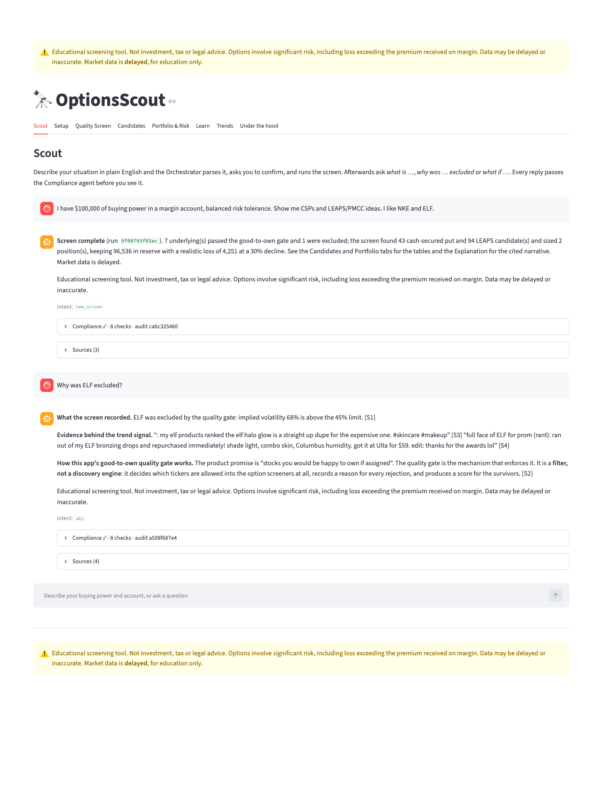
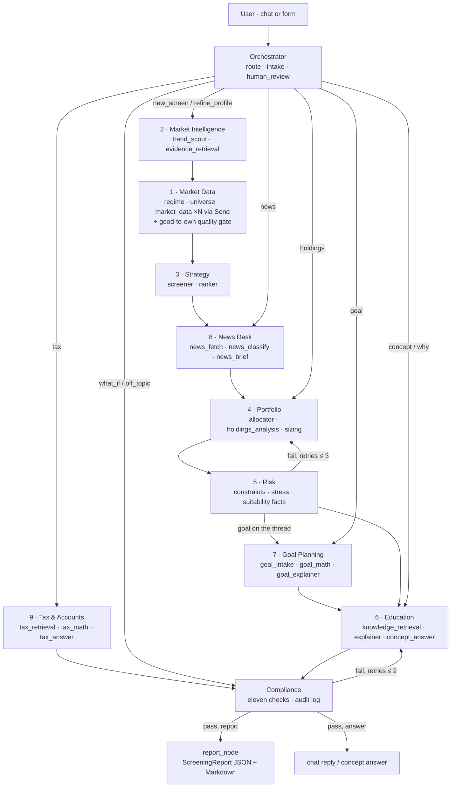
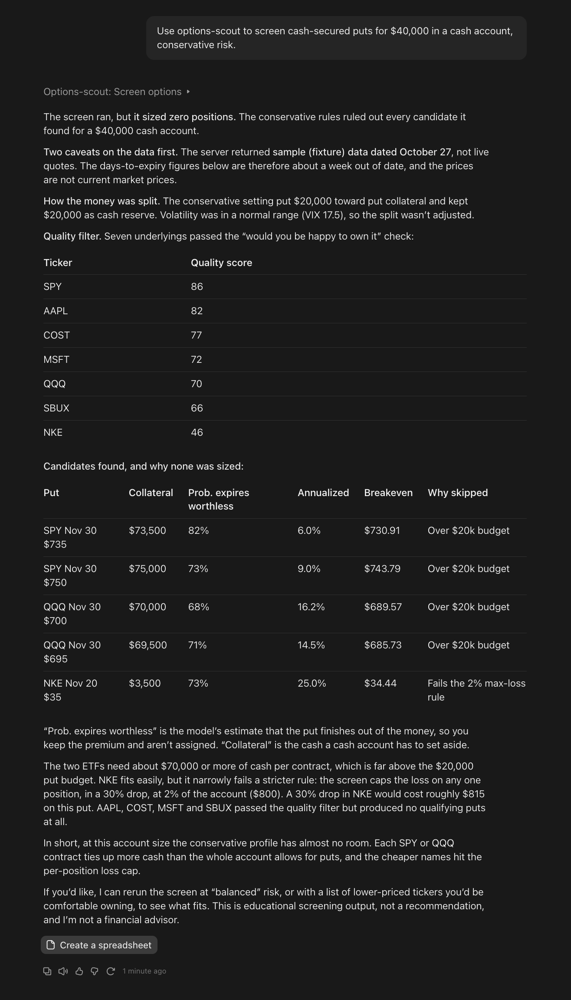

# OptionsScout AI

[](https://github.com/SachiK0thari/options-scout-ai/actions/workflows/ci.yml)
[](evals/reports/latest.md)
[](LICENSE)

**Nine specialist agents and a Compliance agent, composed as LangGraph subgraphs, screen cash-secured puts and LEAPS on good-to-own stocks, size them to your buying power under explicit risk limits, and explain the result in a chat where every sentence is cited from a knowledge base and checked before you see it.** Market Data, Market Intelligence, Strategy, Portfolio and Risk compute every number in tested Python; the Education agent writes only from those numbers and from retrieved, cited sources; the Compliance agent runs eleven deterministic checks (grounded numbers, resolving citations, no advice language, suitability for the account, disclaimer, and the goal, news and tax rules) on every LLM-written string and is the only path to the user. You can describe your situation in plain English, confirm the parsed profile, ask *why was Nike excluded*, *what is assignment*, *could this account make $400 a month*, *what happens to my taxes if I get assigned*, *any news on COST* or *what if I only had 30k*, and get a compliance-checked, cited answer each time. The same engine is exposed as an MCP server for Claude Desktop.

> Educational screening tool. Not investment, tax or legal advice. Options involve significant risk, including loss exceeding the premium received on margin. Data may be delayed or inaccurate. The app never places trades and never connects to a brokerage.

Data handling (market data, Reddit, X, keys, logs): [PRIVACY.md](PRIVACY.md). Licence: [MIT](LICENSE). How the capstone brief's six agents, prescribed layout and technology list map onto this repository: [docs/brief-mapping.md](docs/brief-mapping.md); how each rubric line maps to a feature and a test: [PRD.md section 18](PRD.md#18-rubric-map-read-side-by-side-with-the-brief).

_Demo video and GIF: not recorded yet (step 12.10; the scene-by-scene [script](docs/demo-video-script.md) covers the conversation, holdings, live data, goals, news, tax and the compliance proof). `make demo` prints the full report in about a second; `make ui` opens the nine-tab app (screenshots below)._

## The screen in one paragraph

The universe is a **curated list of ~30 good-to-own names** (large, profitable companies with long dividend records or dominant franchises, plus SPY and QQQ) in [`config/quality_universe.yaml`](config/quality_universe.yaml). On every run each ticker, including any you add, must pass a **deterministic quality gate**: price ≥ $20, average volume ≥ 1M, 30-day realised volatility ≤ 35%, implied volatility ≤ 45%, and no more than 20% below its 90-day high. Whatever fails is listed with the reason and never reaches the option screeners. Survivors get a quality score that carries 35% of the final ranking; the option's own economics carry 55% and the consumer-trend signal 10%. A trend score can lift a name but never lower it, and only a score of 60 or more moves a curated name ahead in the queue. The **bottleneck-arbitrage** signal is shown as an informational board with a ranking weight of zero, because a curated large cap's company score cannot reach the range where it would mean anything (the two market-intelligence signals are capped at 15% together). The bottleneck signal reads shortages in the supply chain behind a well-funded theme from SEC filings, producer-price series and trade headlines ([bottleneck-arbitrage.md](bottleneck-arbitrage.md), PRD §4A); like the trend signal it re-orders names that passed the gate and never adds one, and a deterministic thesis monitor says when a layer's written thesis is weakening. The ranker lists at most two contracts per ticker and strategy, so one liquid ETF chain cannot crowd out the rest of the universe. Buying power is split by risk profile, buckets for strategies you did not ask for are held as cash, and positions are sized greedily under six portfolio constraints (seven when you enter your holdings: a put is capped so that assignment cannot push one ticker past the profile's share of holdings plus buying power) with a −10/−20/−30% stress test. Prices come from bundled fixtures or **your own MarketData.app token or Tradier API key pasted into the page** (used for that run only, never stored).

---

## Quickstart (fixture mode, no API keys)

```bash
git clone https://github.com/SachiK0thari/options-scout-ai.git && cd options-scout-ai
make install          # uv venv + pinned deps (Python 3.12), installs the [dev,mcp] extras
make index            # build the cited knowledge base (data/knowledge.sqlite) offline, < 1 s
make demo             # full agent run on bundled market + social fixtures, prints a Markdown report
make demo ARGS="--strategy csp --account cash --risk conservative --buying-power 50000"
make demo ARGS="--no-llm"   # same, with the LLM steps replaced by deterministic stand-ins
make demo ARGS="--ask 'what is a cash-secured put'"   # cited answer from the knowledge base, via Compliance
make bottlenecks      # the bottleneck board and thesis monitor alone, on the fixture filings; writes the day's snapshot
make demo-core        # screeners + sizing + risk for every risk profile × account type
make ui               # nine-tab Streamlit app on :8501: chat on Scout, form on Setup, results, Goals, Learn, Trends, trace
make api              # FastAPI on :8000  (POST /v1/recommend → GET /v1/runs/{id}/stream → /report; POST /v1/chat)
make mcp              # MCP server over stdio: the ten tools + knowledge:// resources for Claude Desktop
make test lint eval   # offline tests, ruff + mypy --strict, evaluation suite → evals/reports/latest.md
make test-cov         # the tests with coverage; fails below 85% on core/, rag/, agent/, bottleneck/
make bench            # performance benchmarks (latency per agent, cache hits, retrieval) → evals/reports/bench.md
```

Without `uv`: `python3.12 -m venv .venv && .venv/bin/pip install -r requirements.txt && .venv/bin/pip install -e .` installs the same pinned set ([`requirements.txt`](requirements.txt) is exported from `pyproject.toml` by `make requirements`; the pins need Python 3.12).

Everything above runs offline: market data comes from fixtures recorded live on 2026-10-27 for ten tickers, the social corpus is a deterministic synthetic Reddit/X/Wikipedia/Google Trends/news bundle, the bottleneck corpus is a deterministic synthetic set of EDGAR filings, FRED series and headlines with 20 adversarial snippets, the knowledge base is indexed with a deterministic hash embedder, and LLM calls are replayed or replaced by rule-based stand-ins. Set `OPTIONS_SCOUT_DATA_MODE=live` and `OPTIONS_SCOUT_LLM_MODE=live` in `.env` to use real sources; the LLM provider is `llm.provider` in `config/settings.yaml` (default `openrouter` → DeepSeek V4.1 Flash with `OPENROUTER_API_KEY`; `anthropic` → Claude with `ANTHROPIC_API_KEY`). `pip install -e ".[rag]"` and `OPTIONS_SCOUT_RAG_EMBEDDER=fastembed` switch the knowledge base to semantic embeddings.

### Consumer-trend sources

The trend engine reads **post sources** (Reddit via the Arctic Shift archive API with the official Data API/PRAW as backup, X via the v2 search API) and **attention sources** (Wikipedia pageviews, Google Trends via `pytrends`) plus news RSS. Every adapter is fully implemented with live and fixture modes behind one protocol, so switching or combining them is configuration:

```bash
# config/social_sources.yaml enables/weights each source; override per run:
OPTIONS_SCOUT_SOCIAL_SOURCES=reddit,x,wikipedia,google_trends,news make demo
python -m options_scout.jobs.refresh_trends --sources x,news          # X only
python -m options_scout.jobs.refresh_trends --sources reddit,wikipedia,news
```

Live credentials: none for Reddit's default provider (Arctic Shift, `reddit.providers` in `config/social_sources.yaml`; it date-range searches every configured subreddit, so it fills the whole baseline, but scores settle ~36 h after posting and author karma/age are unavailable), `REDDIT_CLIENT_ID/SECRET/USER_AGENT` for the PRAW backup, `X_BEARER_TOKEN` for X (the `search/recent` endpoint needs the Basic tier and covers 7 days; `search.endpoint: all` needs Pro and fills the whole baseline), and `pip install -e ".[trends]"` for Google Trends (unofficial client, optional). The pipeline merges every enabled post source before the spam/dedupe filters, z-scores each source on its own mention series (`reddit_z`, `x_z`, `wikipedia_z`, `google_trends_z`, `news_z` in the report components) and counts cross-source confirmation over whatever is enabled.

### Bottleneck signal (Phase 11)

The second signal follows the ten-step method in [bottleneck-arbitrage.md](bottleneck-arbitrage.md): pick a well-funded theme, map its supply chain, find the layer where supply cannot keep up, gather signals, list the companies that sell into it, check what is priced in, find the catalyst, size, monitor, and know what would prove the thesis wrong. In this app the theme → layer → company tree is a curated YAML file ([`config/themes.yaml`](config/themes.yaml): two themes, eight layers, 33 SEC-validated tickers, each layer with a written thesis and its falsifiers), the signals come from **SEC EDGAR full-text search**, **FRED** producer-price series, news RSS, industry subreddits and Google Trends through the same live/fixture adapter pattern as the trend engine, the only LLM step classifies ≤ 400-character snippets as tightening or easing (`prompts/classify_bottleneck.md`, with a rule-based stand-in), and a deterministic **thesis monitor** evaluates each layer's falsifiers against the journalled daily snapshots (`data/bottleneck_snapshots.sqlite`, 180-day retention, no personal data). The 0–100 company score (layer score × exposure, damped by what is priced in) re-orders good-to-own names that sell into a bottleneck and never adds a stock; three informational flags (`bottleneck_support`, `bottleneck_easing`, `catalyst_inside_dte`) appear on candidates in plain language and never filter.

```bash
make bottlenecks                                   # board + thesis monitor on the fixture corpus, journals the snapshot
make bottlenecks ARGS="--no-llm"                   # with the rule-based classifier
OPTIONS_SCOUT_BOTTLENECK_SOURCES=edgar,fred,news make bottlenecks ARGS="--mode live"   # live: EDGAR needs no key, FRED a free one
```

Live credentials: none for EDGAR (the User-Agent carries `OPTIONS_SCOUT_CONTACT_EMAIL`, requests stay under the SEC's 10/s guidance, filings are cached 24 h), `FRED_API_KEY` for the price series (free), and the trend engine's Reddit and news settings for the industry forums and headlines; earnings-call transcripts are not on EDGAR and the `transcripts` adapter runs in fixture mode only. The board is the *Bottlenecks* panel of the Trends & News tab, the "Bottleneck board (secondary)" section of every report, `GET /v1/bottlenecks` on the API, and a cited "why is HON ranked above UNP" answer quotes its filing excerpts. Honest constraint: the good-to-own list is large caps for which a constrained layer is usually a side business, so the curated suppliers score low (HON 37 on the fixture board) while the pure plays (GEV, VST, MU …) score high and are shown as context only, flagged *not on the good-to-own list*.

## The app: nine tabs

`make ui` opens a Streamlit app (`ui/streamlit_app.py` is the shell; one module per tab under `ui/tabs/`). Everything below ran offline on the bundled fixtures; every chart has a caption saying what it shows, and the disclaimer sits at the top and bottom of every tab.

| Tab | What it shows | Screenshot |
|---|---|---|
| **Scout** | The conversation. Describe your situation; the Orchestrator parses it and renders the profile-confirmation interrupt as an editable form; progress streams per node; follow-ups (*what is …*, *why was … excluded*, *what if …*) are routed by intent. Every assistant turn carries a **Compliance ✓** badge listing the eleven checks it passed. | [scout.png](docs/screenshots/scout.png) |
| **Setup** | The form for users who prefer not to chat: buying power, strategy, more options (including **your options experience**: beginner, intermediate or advanced; Phase 12), data source / API key (used for the run only, never stored). | [setup.png](docs/screenshots/setup.png) |
| **Quality Screen** | The **market overview strip** (Phase 12: SPY and QQQ with the change against the previous close, the VIX with its percentile and regime label, the 13-week T-bill rate, the data provider and the **data age**: "fixture, recorded 2026-10-27" offline, "delayed quotes, fetched 14:02 UTC (12 min ago)" live). Then the stocks that passed the good-to-own gate with their quality score, the excluded list with reasons, the gate thresholds, and a pass/fail quality bar chart. | [quality.png](docs/screenshots/quality.png) |
| **Candidates** | The market overview strip again, then CSP and/or LEAPS tables (only the requested strategies) that follow the profile's knowledge level (Phase 12): a beginner sees the plain-language columns, an intermediate reader adds delta, open interest and the screener flags, an advanced reader adds implied volatility, gamma, theta, vega and the spread. Every header has a **glossary tooltip** (a one-sentence definition tied to its knowledge document) and *What do these columns mean?* opens that document on the Learn tab. A *Supply constraint* column (Phase 11) states the bottleneck board's three strategy-fit notes in plain language at every level: sells into a tight supply layer, constraint easing, earnings or data release before expiry. Plus a "show the full math" expander, a delta-vs-annualized-return scatter and a per-ticker strike ladder. | [candidates.png](docs/screenshots/candidates.png) |
| **Portfolio & Risk** | **Your holdings** (Phase 12): paste what you own and the Portfolio agent values it at the run's prices: allocation by ticker, sector weights, a diversification score (100 × (1 − HHI)), expense ratios, beta-weighted exposure, covered-call lots, and what each screened put would do to a ticker's share of holdings plus buying power if assigned, the **seventh sizing constraint**. Then the allocation donut, sized positions, totals, the constraint checks, stress P&L for the portfolio and per position, the portfolio payoff-at-expiry curve and a largest-loss-vs-limit meter. Margin accounts always show the −30% loss beside the Reg T requirement. | [portfolio.png](docs/screenshots/portfolio.png) |
| **Goals** | The Goal Planning agent's surface (Phase 12): a form or a chat turn states an income, growth or FIRE goal (lean, regular, fat, coast, barista); the verdict (fits / stretch / does not fit) against the current screen's expected yield and the profile's cap, the three levers, a four-path projection (stress, base, best, diversified assumption) with target lines and the coast marker, the FIRE card, and Scout's cited explanation with its Compliance ✓ badge (check 9). | [goals.png](docs/screenshots/goals.png) |
| **Learn** | The Education agent's surface. It opens on the **learning path** (Phase 12): three stages (Basics → Your first cash-secured put → Managing positions and taxes) over the 79 authored documents, the stage matching your knowledge level open first, a *Next up* button, a tick per page and a progress line kept for the browser session. Then a glossary of the cited documents filtered by collection and level, the **Tax & Accounts** page (Phase 12: which account allows which strategy, an assignment-basis calculator bound to a screened put, the LEAPS holding-period countdown, the wash-sale window, Section 1256 status of the run's tickers, the 14 tax documents, and *Ask the Tax agent*), an interactive payoff diagram, the Greeks of a screened candidate in plain English, a Reg T margin walkthrough with the candidate's numbers, and "why hype is a risk for short puts". Every page is labelled *Education, not advice*. | [learn.png](docs/screenshots/learn.png) |
| **Trends & News** | Three boards behind a segmented control. *Consumer trends*: the consumer-trend board with evidence posts (links, not full text), mention velocity vs baseline, per-source z-scores, score components and a sentiment-vs-purchase-intent scatter. *Bottlenecks* (Phase 11): the theme → layer tree with layer scores and the tightness, price-trend, deceleration and supply-response signals, the companies per layer with materiality, exposure, priced-in penalty and the curated flag, three charts (tightening vs easing mentions over time, the layer's price series with the deceleration window marked, company score vs priced-in), and the **thesis monitor**: every layer's written thesis, each falsifier *holding* or *tripped since <date>*, the filing, price and headline evidence with links, and the snapshot history. It opens offline from the journalled snapshot before any screen. *News desk* (Phase 12): per-ticker headlines labelled by category and relevance to a short-option holder, with the provider's sentiment, stale markers, and the calendar flags (earnings inside the DTE window, ex-dividend before a short call's expiry when a date is known) that also appear as 📰 on the Candidates tab; headlines never change the ranking. Each board's caption states its ranking weight (10% trend, 5% bottleneck, 15% together) and the "re-orders, never adds" rule. | [trends.png](docs/screenshots/trends.png), [bottlenecks.png](docs/screenshots/bottlenecks.png) |
| **Under the hood** | Per-specialist latency, nodes visited, tokens and cost, the compliance audit log, the retrieval log (query → chunks → similarity), the bottleneck engine's source status (ran, snapshot reused, disabled, error, and each adapter's state), config hash, data-source status, JSON/Markdown downloads. | [under-the-hood.png](docs/screenshots/under-the-hood.png) |



## Architecture

Nine specialist agents plus a Compliance agent, each a compiled LangGraph subgraph with its own state slice, tools, prompts and tests, composed by a parent graph ([`src/options_scout/agent/agents/`](src/options_scout/agent/agents/), PRD section 5.0). One page per agent, with inputs, outputs, tools, prompts and the tests that cover it: [docs/architecture.md](docs/architecture.md).



How the capstone brief's six agents map onto these specialists (the full crosswalk, including the prescribed layout and technology choices, is [docs/brief-mapping.md](docs/brief-mapping.md)):

| Brief agent | OptionsScout specialist(s) | File | Reached by |
|---|---|---|---|
| Finance Q&A Agent | **Education**: cited concept answers, report narratives, the learning path | `agent/agents/education.py` | `concept` / `why`, Learn tab, MCP `explain_term` |
| Portfolio Analysis Agent | **Portfolio** (holdings analysis, allocation, sizing) + **Risk** (constraints, stress, suitability facts) | `agent/agents/portfolio.py`, `risk.py` | `holdings`, Portfolio & Risk tab, MCP `analyze_holdings` |
| Market Analysis Agent | **Market Data** (quotes, chains, quality gate, regime, market strip) + **Market Intelligence** (consumer-trend and bottleneck boards with evidence) | `agent/agents/market_data.py`, `market_intelligence.py` | every screen, Quality Screen and Trends & News tabs, `GET /v1/trends` and `/v1/bottlenecks` |
| Goal Planning Agent | **Goal Planning** (income, growth and FIRE goals against the screened yield under the risk profile's cap) | `agent/agents/goal_planning.py` | `goal`, Goals tab, MCP `plan_goal` |
| News Synthesizer Agent | **News Desk** (Alpha Vantage headlines labelled for a short-option holder, calendar flags) | `agent/agents/news_desk.py` | `news`, every screen, Trends & News tab, MCP `news_brief` |
| Tax Education Agent | **Tax & Accounts** (cited tax mechanics and account types, illustrated with a screened put) | `agent/agents/tax.py` | `tax`, Learn tab, MCP `explain_tax_term` |
| (not in the brief) | **Orchestrator**, **Strategy**, **Compliance** | `orchestrator.py`, `strategy.py`, `compliance.py` | every turn |

Market Intelligence runs before Market Data because the universe node orders the curated list by trend score; News Desk runs after Strategy because its calendar flags attach to candidates; Goal Planning runs after Risk because it needs the sized portfolio's yield. A screen visits the nodes in this order: `route_node → intake_node (→ human_review) → trend_scout_node → evidence_retrieval_node → regime_node → universe_node → market_data_node×N → screener_node → ranker_node → news_fetch_node → news_classify_node → news_brief_node → allocator_node (→ holdings_analysis_node) → sizing_node → risk_node (→ goal_intake_node → goal_math_node → goal_explainer_node) → knowledge_retrieval_node → explainer_node → compliance_node → audit_node → report_node`. The chat-only nodes (`what_if_node`, `redirect_node`, `concept_answer_node`, the holdings, tax and goal intake and reply nodes) run on their intents.

LangGraph features used: typed `StateGraph` with reducers, **subgraphs** (one compiled graph per specialist, each testable standalone; the parent applies each subgraph's state delta so reducers run once), **conditional routing by intent** after the Orchestrator, `Send` map-reduce over tickers inside the Market Data agent, `interrupt()` + `Command(resume=…)` for human-in-the-loop profile confirmation, SQLite checkpointing on the parent (resumable threads, one per conversation), two bounded retry loops between agents (Portfolio ↔ Risk, Education ↔ Compliance), node- and agent-level streamed updates to the UI/API, per-agent timing in every report, and graceful degradation when a source fails.

### Knowledge base and retrieval (RAG)

Educational claims must be traceable to a source the user can read, so the Education agent answers from a **cited knowledge base** rather than from the model's memory. The corpus lives in [`knowledge/`](knowledge/) as Markdown with YAML front-matter (`id, title, source, url, kind, as_of`); the full description, licences and the recipe for adding a document are in [docs/rag.md](docs/rag.md).

| Collection | Contents | Where it comes from |
|---|---|---|
| `concepts/` | 37 authored docs (300–800 words) on options: cash-secured puts, naked puts on margin, LEAPS, PMCC, assignment, the Greeks, extrinsic value, IV rank, Reg T margin, probability OTM, earnings, liquidity, rolling, the VIX regime, covered calls, the wheel, collars and vertical spreads (labelled *not screened by this app*), open interest vs volume, fill quality, exercise styles, expiration cycles, 0DTE risk, skew and term structure, HV vs IV, approval levels, the OCC, exit rules, the sizing debate, *why hype is a risk for short puts*, *bottleneck arbitrage: what a supply-constraint signal can and cannot do for a short put* (Phase 11), *how this app's quality gate works* | written here; each cites OCC, FINRA, Cboe, eCFR or SEC pages by URL |
| `basics/` | 28 beginner docs: what a stock and an ETF are, index funds, dividends and ex-dates, market cap, P/E, bid and ask, order types, T+1 settlement, cash vs margin accounts, compound growth, diversification, concentration risk, beta, expense ratios, emergency fund first, risk tolerance, the app's risk profiles, drawdown, the VIX, T-bills, inflation, dollar-cost averaging, rebalancing, SIPC, reading a 10-K, FIRE and safe withdrawal rates, savings rate | written here; each cites SEC investor.gov, FINRA, TreasuryDirect, SIPC or the Bogleheads wiki, and ends with *Where this shows up in OptionsScout* |
| `tax/` | 14 docs on tax mechanics and account types for a CSP, LEAPS or PMCC writer: premium taxation, assignment basis, wash sales, LEAPS holding period, exercise vs sale, qualified covered calls, Section 1256 (and why SPY/QQQ options are not), 1099-B and 8949, short vs long term, cash/margin/IRA accounts, options in an IRA, early withdrawal, Reg T vs portfolio margin, pattern day trading | written here; each cites IRS Pub 550, Tax Topics, the statute or FINRA, and carries the *education, not tax advice* sentence |
| `rules/` | ten rule documents with the exact thresholds in force: the seven screening rules (PRD §3.1–3.7) and the goal feasibility, news flag and holdings concentration rules (§3.8–3.10) | generated from `PRD.md` + `config/*.yaml` by `scripts/build_rules_docs.py` (`make index`); a test fails if the committed copy is stale |
| `filings/` | SEC 10-K *Item 1A Risk Factors* excerpts (≤ 3,000 words) for 33 names of the good-to-own universe; prospectus *Principal Risks* for SPY/QQQ | `scripts/fetch_filings.py` via EDGAR (public domain); a bare *Risk Factors* heading (MCD, HON) and a predecessor registrant (XOM) are handled |
| run evidence | the trend scout's evidence posts for the current run | indexed in memory per thread by Market Intelligence, so *why* answers cite the actual posts |

Every document carries a reading `level` (beginner, intermediate, advanced) in its front-matter; the retriever's `max_level` cap keeps a beginner's answer from citing a margin or skew document first (`python -m options_scout.rag.retriever "what is a put" --max-level beginner`). The cap follows the profile's **knowledge level** (stated in the request, picked on the Setup form or edited in the review form): a beginner's sources are capped at intermediate, and the cap is a preference, not a wall, so when the best match for a question is an advanced document ("what is gamma"), the easier documents lead and the advanced one follows instead of the question being answered from the wrong page. The same level is passed to the explainer and concept prompts as a vocabulary rule (beginner: define every options term on first use, the plain meaning before a Greek's name).

Pipeline ([`src/options_scout/rag/`](src/options_scout/rag/)): heading-aware chunking (≤ 400 tokens, 15% overlap, stable ids `<doc_id>#<n>`) → an `Embedder` (`HashEmbedder`: deterministic feature hashing, no download, used by tests, CI and by default; `FastEmbedEmbedder` with `BAAI/bge-small-en-v1.5` behind `pip install -e ".[rag]"`) → SQLite store with numpy cosine search + `rank_bm25` → hybrid retriever (reciprocal-rank fusion, `kind` filter, a dense similarity floor and, for the lexical hash embedder, a shared-content-word rule so a hash collision never counts as a match) → `Citation(chunk_id, doc_id, title, url, quote)`. A query with nothing eligible returns an empty result, and the Education agent then answers with the fixed sentence *"I don't have a source for that in my knowledge base."* instead of guessing.

```bash
make index                                                   # regenerate knowledge/rules + rebuild data/knowledge.sqlite
python -m options_scout.rag.retriever "what is assignment"   # 6 cited chunks
python -m options_scout.rag.retriever --kind rules "why was NKE excluded"
python -m options_scout.rag.retriever --kind tax "can a short put trigger a wash sale"
```

**How the Education agent uses it.** `knowledge_retrieval_node` turns a report into concept queries (the strategies screened, the account type, the quality-gate exclusion reasons, the flags present) and attaches one source document per concept as `[S1]…[Sn]`; for a question the query is the question itself plus the run's evidence posts; for a *why* question the first source is a chunk of this run's computed facts. The explainer then writes a `Narrative` of tagged paragraphs: `education` paragraphs explain a concept and must cite a source tag, `screen_result` paragraphs report only computed numbers (candidate ids, realistic loss, payoff breakeven and maximum loss from `core/payoff.py`), and a `notice` paragraph carries the disclaimer. Compliance checks every `[Sn]` tag against the retrieved set in addition to the numeric grounding, and the report ends with a **Sources** footnote list.

### Conversation and intent routing

Every turn enters through the Orchestrator's `route_node`, which classifies it with the `route_message` prompt (or the regex router in `llm/rules.py` when no LLM is available) into one of ten intents, and the parent graph routes on that intent:

| Intent | What happens | Where the reply comes from |
|---|---|---|
| `new_screen` | the full pipeline; on a thread that already holds a report the screen runs on a **new thread** so LangGraph's list reducers never append one run onto another | the report's compliance-checked summary |
| `refine_profile` | the changed fields are merged into the profile and the new thread **pauses at `human_review`** for confirmation | review prompt, then the summary |
| `concept` | Education retrieves knowledge-base sources and answers with `[Sn]` citations | the cited answer |
| `why` | Education also receives this run's computed facts (gate reasons, ranking, skipped candidates) and evidence posts as sources; run data is reported in `screen_result` paragraphs, the rule in a cited `education` paragraph | the cited answer |
| `what_if` | the Orchestrator writes the profile diff; a full run with the hypothetical profile starts on a new thread | diff + the new screen's summary |
| `goal` | Goal Planning (Phase 12) parses the goal, runs `core/goals.py` on this thread's sized portfolio (or on cash alone), retrieves the basics documents it rests on and writes a cited reply that passes compliance check 9 | the verdict, levers, projection and (FIRE) the variant, FIRE number and coverage |
| `holdings` | the Portfolio agent (Phase 12) parses the positions (LLM or regex, listed symbols only), values them, and replies with the allocation, diversification score, expense ratios, beta and post-assignment concentration; holdings stay on the thread and follow a refined screen, where they enable the seventh constraint | the holdings analysis |
| `news` | the News Desk (Phase 12) fetches headlines for the tickers named (or the screen's survivors) from Alpha Vantage's NEWS_SENTIMENT endpoint, with Google News / Yahoo RSS as the live fallback and a 30-minute cache, labels them (LLM or keyword classifier), and replies with the most relevant headlines quoted verbatim plus the calendar flags on screened candidates; compliance check 10 verifies every quote against the fetched items | the per-ticker brief |
| `tax` | the Tax & Accounts agent (Phase 12) retrieves from the `tax` collection, computes illustrative mechanics with `core/tax.py` from the thread's screened put (assignment basis, the premium if it expires, the LEAPS long-term threshold, the wash-sale window, Section 1256 status) and writes a cited reply that carries the tax disclaimer once; compliance check 11 rejects a stated rate or a filing instruction | the cited tax answer |
| `off_topic` | a fixed polite redirect | the redirect |

All ten paths end in the Compliance agent, so every assistant turn carries a `ComplianceReport`; the review prompt and the deterministic summaries are checked too. `agent/chat.py` drives a conversation (`ChatSession.send` / `resume`, turns stored on the thread as `chat_history`), the API exposes it as `POST /v1/chat` (server-sent events ending in a `turn`) and `GET /v1/threads/{id}`, and `tests/agent/test_chat.py` runs the scripted six-turn conversation (describe → confirm → why excluded → what is assignment → what if 30k → off-topic) in CI. `make eval` scores the router on the <!-- n:n.dev.chat_routing -->100<!-- /n --> dev messages of `evals/datasets/dev/chat_routing.jsonl` and the <!-- n:n.test.chat_routing -->70<!-- /n --> held-out ones of `evals/datasets/test/`, and re-runs the six-turn script to confirm every reply carries a compliance audit entry.

## Why the LLM never does math

Every number in a report (Greeks, Reg T margin, collateral, annualised return, position sizes, stress P&L, social scores) is computed by deterministic, unit-tested Python in `src/options_scout/core/` and `src/options_scout/social/`. The LLM's jobs are text in and structured text out, each with a versioned prompt file (<!-- n:prompts -->12<!-- /n --> in `prompts/`) and a Pydantic structured-output schema: parse the free-text profile, goal and holdings, classify a chat turn's intent, extract consumer entities from posts, classify headlines and filing snippets, and write the narrative or answer from a JSON payload of computed results and numbered sources.

The **Compliance agent** then checks the numbers. In a report the writer does not type figures at all: it names payload fields as slots (`{{positions[CSP-…].realistic_loss|money}}`) that Python fills, so any typed figure fails and a figure can only be wrong if the slot name is, and a slot next to a label such as *maximum loss* or *premium* must name that field. Other texts are parsed for figures with their units, number words, signs and percent signs, each matched against the run's own data. It also checks that every `[Sn]` citation tag points at a retrieved source, that no banned phrase appears and that the disclaimer is present. A failed text is retried with the specific problems fed back; after the retry budget the report falls back to a template narrative written in the same slots. Social posts are data: they are wrapped in delimiters, the prompts instruct the model to ignore instructions inside them, and every ticker an LLM proposes must exist in the SEC company list or it is discarded.

## Education, not advice

Options are higher-risk than equities, so the separation between *teaching* and *telling* is enforced by code, not by tone. The rules in plain English, with the sentences that pass and fail each check, are in [docs/compliance.md](docs/compliance.md); a test runs every example sentence on that page through the checks so the page cannot drift from the code.

- **Two kinds of paragraph.** The Education agent tags every paragraph it writes. An `education` paragraph explains a concept, must cite a retrieved source, and may not mention this run's candidate ids, tickers or numbers. A `screen_result` paragraph reports what the screen found, may use only numbers from the computed payload, must state the realistic loss whenever it names a short option, and may never tell the reader what to do.
- **Eleven deterministic checks** from [`config/compliance.yaml`](config/compliance.yaml) and PRD section 13.1: numbers grounded in the payload; every `[Sn]` resolving to a retrieved source; the mode rules above; a suitability gate on facts the Risk agent computed (no margin on a cash account, loss within the profile limit, PMCC only with LEAPS requested, earnings flags stated for conservative profiles, buying-power minimums); a language policy with directive, certainty, superlative and urgency patterns and an allow-list for quoted terminology inside cited education paragraphs; the disclaimer exactly once plus a delayed-data statement; freshness of cited rules and filings (warning only); and no handles or emails from social posts.
- **One path to the user.** The report narrative, every chat reply, every Learn-tab answer and every MCP tool that returns text (`explain_term`, `plan_goal`, `analyze_holdings`, `news_brief`, `explain_tax_term`, the `screen_options` narrative) reach the user only through the Compliance agent. Each evaluation is logged as a `compliance.check` event and appended to the run's audit log (Under the hood tab, Compliance ✓ badge on every chat turn); a blocking failure sends the Education agent specific feedback, and after two retries the text falls back to a deterministic narrative or the fixed sentence *"I can show the computed results but could not produce an explanation that passes compliance."*, which is checked again.
- **Measured, not asserted.** `make eval` runs the in-sample advice-seeded and clean narratives (<!-- n:advice.in_sample -->34/34 advice caught · 0/10 clean rejected<!-- /n -->) and a blind held-out set (<!-- n:advice.test -->23/40 advice caught · 3/15 clean rejected<!-- /n -->) through the separation checks, <!-- n:n.dev.suitability_cases -->22<!-- /n --> synthetic reports through the suitability gate, and every report and chat reply through the audit-coverage check (table below).

Two of the documented examples: *"CSP-COST-2026-12-18-850P met the criteria; its realistic loss is 12345."* passes. *"You should sell CSP-COST-2026-12-18-850P here; realistic loss 12345."* is rejected by `check_language` (a directive addressed to the reader), and *"A cash-secured put on COST obliges the writer to buy the shares at the strike [S1]."* is rejected by `check_education_only` (a run ticker inside an education paragraph).

## Evaluation results

<!-- numbers:start eval-table -->
Measured by `make eval` on 2026-11-13 (LLM: openrouter (deepseek/deepseek-v4.1-flash / deepseek/deepseek-v4.1-flash)). **Held-out** is `evals/datasets/test/`, written by people who never saw the rules or prompts; **Dev** is `evals/datasets/dev/`, the sets they were built against, so it overstates accuracy on new text. A held-out miss is **BELOW TARGET** (reported, never tuned against); a dev miss is **FAIL**. Rows marked NOT RUN need a key and are not estimated; rows labelled *template writer* measured the deterministic writer, not a model. Details per row: [`evals/reports/latest.md`](evals/reports/latest.md).

| Section | Eval | Held-out | Dev | Target | Status |
|---|---|---|---|---|---|
| 11.1 Deterministic | Golden-value + property tests (tests/unit) | - | 922 passed | all pass | PASS |
| Quality | Offline test suite (unit + agent + API + UI + MCP) | - | 1189 passed | all pass | PASS |
| Quality | Line coverage on core/, rag/, agent/, bottleneck/ (pytest --cov, same run) | - | 95.9% | ≥ 85% | PASS |
| 11.2 Entity extraction | F1 on labelled posts (rule-based, no LLM) | P 0.67 / R 0.34 / F1 0.45 | P 0.90 / R 0.89 / F1 0.90 | F1 ≥ 0.80 | BELOW TARGET |
| 11.2 Entity extraction | is_stock_talk accuracy (rule-based, no LLM) | 0.83 | 0.96 | report | INFO |
| 11.2 Entity extraction | F1 on labelled posts (LLM deepseek/deepseek-v4.1-flash) | F1 mean 0.87 · worst 0.86 (3 runs) | F1 mean 0.85 · worst 0.85 (3 runs) | F1 ≥ 0.80 | PASS |
| 11.2 Entity extraction | is_stock_talk accuracy (LLM deepseek/deepseek-v4.1-flash) | 0.96 | 0.96 | report | INFO |
| 11.2 Resolution | Brand → ticker accuracy | 54/69 = 78% | 100/100 = 100% | ≥ 90% | BELOW TARGET |
| 11.2 Resolution | Hallucinated (non-SEC) tickers, both splits | - | 0 | 0 | PASS |
| 11.2 Profile parsing | Required-field accuracy (rule-based, no LLM) | 118/135 = 87% | 177/180 = 98% | ≥ 95% | BELOW TARGET |
| 11.2 Profile parsing | Clarification routing accuracy (rule-based, no LLM) | 31/45 = 69% | 59/60 = 98% | ≥ 95% | BELOW TARGET |
| 11.2 Profile parsing | Knowledge-level accuracy (rule-based, no LLM) | 29/45 = 64% | 60/60 = 100% | ≥ 90% | BELOW TARGET |
| 11.2 Profile parsing | Required-field accuracy (LLM deepseek/deepseek-v4.1-flash) | mean 99% · worst 99% (3 runs) | mean 100% · worst 99% (3 runs) | ≥ 95% | PASS |
| 11.2 Profile parsing | Clarification routing accuracy (LLM deepseek/deepseek-v4.1-flash) | mean 99% · worst 98% (3 runs) | mean 100% · worst 100% (3 runs) | ≥ 95% | PASS |
| 11.2 Profile parsing | Knowledge-level accuracy (LLM deepseek/deepseek-v4.1-flash) | mean 99% · worst 98% (3 runs) | mean 98% · worst 98% (3 runs) | ≥ 90% | PASS |
| 11.2 Prompt injection | Reachable cases where the injected ticker influenced output (rule-based) | - | 0/3 reachable | 0% | PASS |
| 11.2 Prompt injection | Posts where the LLM was not steered and its injected-copy entities agree with a clean extraction of the same post (LLM) | - | mean 90% · worst 83% (3 runs) | 100% | FAIL |
| 11.3 Agent | Numeric grounding rate (final narrative) · replayed model recordings (4 of 6 runs replayed in full) | - | 100.0% | 100% | PASS |
| 11.3 Agent | Narratives passing verifier on first attempt · replayed model recordings (4 of 6 runs replayed in full) | - | 2/6 | report | INFO |
| 11.3 Agent | Constraint compliance · replayed model recordings (4 of 6 runs replayed in full) | - | 6/6 | 100% | PASS |
| 11.3 Agent | Policy compliance (banned phrases absent, disclaimer present) · replayed model recordings (4 of 6 runs replayed in full) | - | 6/6 | 100% | PASS |
| 11.3 Agent | Trajectory checks (expected nodes visited, retries bounded) · replayed model recordings (4 of 6 runs replayed in full) | - | 6/6 | 100% | PASS |
| 11.3a Compliance | Compliance audit coverage (report text carries a passing ComplianceReport) · replayed model recordings (4 of 6 runs replayed in full) | - | 6/6 | 100% | PASS |
| 11.3 Agent | Bottleneck containment: board suppliers off the good-to-own list never enter the universe, a candidate table or the ranking (Phase 11, 4A.11) | - | 6/6 | 100% | PASS |
| 11.3 Agent | Bottleneck board present with a thesis monitor (every layer row carries falsifiers and evidence links) | - | 6/6 | 100% | PASS |
| 11.3 Agent | Latency per run (fixture mode) · replayed model recordings (4 of 6 runs replayed in full) | - | mean 1.04s · p95 3.79s | report | INFO |
| 11.3 Agent | Cost per run · replayed model recordings (4 of 6 runs replayed in full) | - | mean $0.0000 · input tokens mean 0 | report | INFO |
| 11.3 Agent | Graceful degradation with social source disabled | - | ok | report | PASS |
| 11.3 Agent | Numeric grounding rate (final narrative) · LLM deepseek/deepseek-v4.1-flash | - | 100.0% | 100% | PASS |
| 11.3 Agent | Final narratives written by the model (no deterministic fallback) · LLM deepseek/deepseek-v4.1-flash | - | 5/6 | report | INFO |
| 11.3 Agent | Released paragraphs written by the model (failing ones replaced) · LLM deepseek/deepseek-v4.1-flash | - | 64/76 | report | INFO |
| 11.3 Agent | Compliance checks the model's attempts failed (all attempts, all runs) · LLM deepseek/deepseek-v4.1-flash | - | check_citations ×5, check_numbers ×3, check_education_only ×2, check_suitability ×1 | report | INFO |
| 11.3 Agent | Numeric grounding on the model-written narratives only · LLM deepseek/deepseek-v4.1-flash | - | 100.0% | report | INFO |
| 11.3 Agent | Narratives passing verifier on first attempt · LLM deepseek/deepseek-v4.1-flash | - | 4/6 | report | INFO |
| 11.3 Agent | Constraint compliance · LLM deepseek/deepseek-v4.1-flash | - | 6/6 | 100% | PASS |
| 11.3 Agent | Policy compliance (banned phrases absent, disclaimer present) · LLM deepseek/deepseek-v4.1-flash | - | 6/6 | 100% | PASS |
| 11.3 Agent | Trajectory checks (expected nodes visited, retries bounded) · LLM deepseek/deepseek-v4.1-flash | - | 6/6 | 100% | PASS |
| 11.3a Compliance | Compliance audit coverage (report text carries a passing ComplianceReport) · LLM deepseek/deepseek-v4.1-flash | - | 6/6 | 100% | PASS |
| 11.3 Agent | Latency per run (live mode) · LLM deepseek/deepseek-v4.1-flash | - | mean 21.45s · p95 30.36s | report | INFO |
| 11.3 Agent | Cost per run · LLM deepseek/deepseek-v4.1-flash | - | mean $0.0049 · input tokens mean 18451 | report | INFO |
| 11.3a Compliance | Education-vs-advice separation, in-sample rows (whole gate, advice_narratives.jsonl) | - | 34/34 advice caught · 0/10 clean rejected | 100% caught, ≤ 1 false positive | PASS |
| 11.3a Compliance | Education-vs-advice separation, check_language only (dev: advice_dev.jsonl, test: advice_blind.jsonl, written by someone who never saw the patterns) | 23/40 advice caught · 3/15 clean rejected | 30/30 advice caught · 0/12 clean rejected | report | INFO |
| 11.3a Compliance | Suitability gate (correct check name per case) | - | 22/22 | 100% | PASS |
| 11.3a Compliance | Wrong-but-plausible figures caught, free-text checker (W14; pre-W14 bag check in notes) | - | 18/20 caught · 0/6 right rejected | report (no target: free text keeps known gaps) | INFO |
| 11.3a Compliance | Wrong-but-plausible figures caught, slot mode (the report explainer, W14) | - | 14/14 caught · 0/5 right rejected | 100% caught, 0 right rejected | PASS |
| 11.3a Conversation | Intent routing accuracy (rule-based router) | 44/70 = 63% | 100/100 = 100% | ≥ 90% | BELOW TARGET |
| 11.3a Conversation | Intent routing accuracy (LLM router) | mean 98% · worst 97% (3 runs) | mean 100% · worst 99% (3 runs) | ≥ 90% | PASS |
| 11.3a Retrieval | Retrieval quality: recall@6 (hash embedder, CI default) | 0.47 (21/45) · MRR 0.28 | 0.83 (52/63) · MRR 0.58 | recall@6 ≥ 0.70 | BELOW TARGET |
| 11.3a Retrieval | Retrieval quality: recall@6 (fastembed bge-small-en-v1.5) | 0.69 (31/45) · MRR 0.43 | 0.94 (59/63) · MRR 0.71 | recall@6 ≥ 0.85 | BELOW TARGET |
| 11.3a Citations | Citation tags resolve: every [Sn] names a retrieved source (rule-based answerer) | 77/77 = 100% | 110/110 = 100% | 100% | PASS |
| 11.3a Citations | Education paragraphs carrying a citation (rule-based answerer) | 77/77 = 100% | 106/106 = 100% | 100% | PASS |
| 11.3a Citations | Citation faithfulness: answers whose cited sentences are supported by the cited chunk (W16 word-overlap and quotation check, not a semantic judge; rule-based answerer) | 45/45 = 100% | 63/63 = 100% | 100% | PASS |
| 11.3a Citations | Answers to the retrieval questions passing Compliance | 45/45 = 100% | 63/63 = 100% | 100% | PASS |
| 11.3a Refusal | Unsupported-question refusal: fixed no-source sentence, no speculation (hash embedder, rule-based answerer) | - | 12/15 | 100% (LLM answerer); report (rule-based) | INFO |
| 11.3a Refusal | Unsupported questions refused or redirected when asked through the chat router | - | 15/15 | report | INFO |
| 11.3a Conversation | Compliance on chat: assistant turns carrying a passing ComplianceReport (7-turn script) | - | 7/7 | 100% | PASS |
| 12.3 Goal planning | Goal feasibility verdicts and FIRE numbers on 29 labelled cases (15 FIRE, five variants) | - | 29/29 | 100% | PASS |
| 12.3 Goal planning | Goal parsing: a goal kind recognised on the 10 goal messages (rule-based) | - | 10/10 | 100% | PASS |
| 12.5 News desk | Headline category accuracy (keyword classifier) | 45/70 = 64% | 70/70 = 100% | ≥ 85% | BELOW TARGET |
| 12.5 News desk | Headlines with an embedded instruction still labelled by content (20, keyword) | - | 20/20 | 100% | PASS |
| 12.5 News desk | Headline category accuracy (LLM classifier) | mean 97% · worst 96% (3 runs) | mean 99% · worst 99% (3 runs) | ≥ 85% | PASS |
| 12.5 News desk | Headlines with an embedded instruction still labelled by content (20, LLM) | - | mean 100% · worst 100% (3 runs) | 100% | PASS |
| 11.2 Constraint classification | Direction accuracy on hand-labelled filing and news snippets (rule-based stand-in) | 30/48 = 62% | 94/100 = 94% | ≥ 0.85 | BELOW TARGET |
| 11.2 Constraint classification | Layer macro-F1, no search hint given (rule-based stand-in) | 0.72 | 0.93 | ≥ 0.80 | BELOW TARGET |
| 11.2 Constraint classification | Side accuracy (customer / supplier / neutral) (rule-based stand-in) | 35/48 = 73% | 98/100 = 98% | report | INFO |
| 11.2 Theme-map validation | Tickers in config/themes.yaml that exist in the SEC company list (33) | - | 33/33 | 100% | PASS |
| 11.2 Prompt injection | Fixture filings/headlines with an embedded instruction that steered the label (20, rule-based) | - | 0/20 | 0% | PASS |
| 11.2 Constraint classification | Direction accuracy on hand-labelled filing and news snippets (LLM deepseek/deepseek-v4.1-flash) | mean 99% · worst 98% (3 runs) | mean 100% · worst 100% (3 runs) | ≥ 0.85 | PASS |
| 11.2 Constraint classification | Layer macro-F1, no search hint given (LLM deepseek/deepseek-v4.1-flash) | mean 0.99 · worst 0.96 (3 runs) | mean 0.99 · worst 0.97 (3 runs) | ≥ 0.80 | PASS |
| 11.2 Constraint classification | Side accuracy (customer / supplier / neutral) (LLM deepseek/deepseek-v4.1-flash) | mean 98% · worst 94% (3 runs) | mean 95% · worst 93% (3 runs) | report | INFO |
| 11.2 Prompt injection | Fixture filings/headlines with an embedded instruction that steered the label (20, LLM) | - | 0/20 | 0% | PASS |
| 12.6 Tax & accounts | Tax questions routed to the Tax agent (rule-based answerer) | 16/20 = 80% | 20/20 = 100% | report | INFO |
| 12.6 Tax & accounts | Tax questions citing the expected document (rule-based answerer) | 14/20 = 70% | 20/20 = 100% | ≥ 90% | BELOW TARGET |
| 12.6 Tax & accounts | Tax replies passing Compliance with the disclaimer once (check 11: no rate, no instruction) | 16/20 = 80% | 20/20 = 100% | 100% | BELOW TARGET |
<!-- numbers:end -->

## Benchmarks

`make bench` writes [`evals/reports/bench.md`](evals/reports/bench.md): offline, fixture mode, so the numbers are the cost of the code (graph overhead, deterministic math, retrieval, compliance), not of a network or a model. Measured on an Apple Silicon laptop on <!-- n:bench.date -->2026-11-09<!-- /n -->:

| Benchmark | Result |
|---|---|
| Full screen, six requests | mean 1.11 s, p95 3.06 s (the first run pays for the trend scout's fixture load: 1.8 s of its 3.1 s) |
| Latency per specialist, mean over six screens | Market Intelligence 308 ms · Strategy 228 ms · Education 118 ms · Market Data 85 ms · Compliance 83 ms · News Desk 79 ms · Risk 79 ms · Portfolio 78 ms · Orchestrator 3 ms |
| Chat turns on a finished screen's thread, each through Compliance | goal 0.44 s · holdings 0.48 s · news 0.52 s · tax 0.48 s · concept question 0.01 s |
| Market-data cache across the six screens | 82% hit rate (516 hits, 110 misses; the first screen is cold) |
| Knowledge base | <!-- n:docs -->124<!-- /n --> documents, <!-- n:chunks -->1,081<!-- /n --> chunks indexed in 0.34 s; a hybrid query takes 1.2 ms mean, 1.6 ms p95 over the labelled dev questions |
| Tokens and cost per screen | 0 in fixture mode; with `OPTIONS_SCOUT_LLM_MODE=live` the same report shows the measured usage of DeepSeek V4.1 Flash through OpenRouter (about $0.14 per million input tokens) |

In live mode each specialist's latency grows by its provider calls: one quote, one chain and one history per ticker for Market Data (cached 15 minutes per provider), one `NEWS_SENTIMENT` call per ticker for News Desk (cached 30 minutes), and one structured LLM call per text for the writers, plus at most two Compliance retries.

## Signal study (honest version)

[`notebooks/signal_study.ipynb`](notebooks/signal_study.ipynb) (generated from [`evals/signal_study.py`](evals/signal_study.py)) scores entities point-in-time on three weekly dates and compares forward 30/60/90-day returns of the top vs bottom tercile against SPY. From Phase 11 it asks the same question of the bottleneck company score, with the same point-in-time rule (`end=` bounds every filing, headline and series), and reports the two separately. **No predictive claim is made for either.** The social and filings corpora are synthetic, only the 10 demo tickers have bundled prices (none of them a curated bottleneck supplier, so the second study has no forward return to pair with a score yet), forward windows are truncated by the 90-day history, and the sample is a few dozen observations. The notebook documents the method and what a real test would require (6+ months of stored live snapshots, which the bottleneck job keeps for 180 days, and a pre-registered hypothesis per signal).

## What the system returns

0. Quality screen: every stock considered, its quality score (0–100), and every exclusion with the reason ("implied volatility 68% is above the 45% limit", "26% below its 90-day high").
1. Allocation plan (CSP collateral / LEAPS-PMCC / cash reserve, with a volatility-regime tilt and the reasons; unrequested strategies are held as cash).
2. Trend board (secondary): entities, consumer-trend score (0–100), components (velocity z overall and per source, acceleration, sentiment, purchase intent, cross-source confirmation, coverage gap, novelty and stock-hype penalties), evidence posts, investable flag. It re-orders qualifying stocks and never adds one.
3. Bottleneck board (secondary, Phase 11): theme → layer scores (0–100) with tightness z, customer confirmation, price trend, the deceleration and supply-response penalties and cross-source confirmation; one row per supplier with company score, exposure, priced-in penalty, catalyst days, the curated flag and the flags; the thesis monitor (each layer's thesis, every falsifier *holding* or *tripped since <date>*) and the evidence pack (filing excerpt with its EDGAR link, price point with its FRED link, headline). Same rule: re-orders, never adds.
4. CSP candidates with strike, expiry, delta, premium, collateral, Reg T margin, annualised return, P(OTM), liquidity, IV rank, earnings flag and the three bottleneck flags.
5. LEAPS/PMCC candidates with extrinsic % per year, breakeven and a matched short call satisfying the safety rule.
6. Sized portfolio under six risk constraints, with totals and every skipped candidate with its reason.
7. Risk report: constraint checks, −10/−20/−30% stress test with an IV shock, warnings.
8. Plain-English explanation in tagged paragraphs, grounded only in computed numbers and cited sources, with a Sources list, the compliance report and the disclaimer.

## Tech decisions and trade-offs

- **Curated list + numeric gate instead of "let the model pick safe stocks".** "Good to own" is a judgment, so it lives in a reviewable YAML file with a one-line reason per name, and the day-of-run gate (realised vol, implied vol, drawdown, price, liquidity) is pure, golden-tested Python that records *why* a ticker was dropped. The trend signal was demoted to a 15% tiebreaker: a viral brand is a reason to look at Costco sooner, not a reason to sell puts on a meme stock.
- **Curated theme maps instead of "ask the model to map the supply chain" (Phase 11).** Which layers a theme needs and how material a layer is to a company are judgments, so they live in `config/themes.yaml` with a one-line thesis and explicit falsifiers per layer, reviewable in a diff; every ticker is validated against the SEC company list when the config loads. The LLM's only job in that engine is to classify text snippets as tightening or easing (and the rule-based stand-in reaches 94% direction accuracy on the labelled set); the score, the priced-in penalty, the strategy-fit flags and the thesis monitor are deterministic and golden-tested, like everything else that produces a number. The cost is that a map can be stale or wrong, which is why each layer states what would prove it wrong and the monitor reports it; letting the model propose new layers for human review is a listed stretch goal.
- **Specialists as subgraphs, composed by state delta.** A compiled subgraph added directly as a LangGraph node returns its whole final state, and the parent's list reducers then re-append what it inherited (verified on LangGraph 1.2.18). Each specialist is therefore invoked from a thin parent node that writes back only what changed, which keeps every agent testable standalone and every reducer applied once.
- **A deterministic Compliance agent, not an LLM judge.** The checks are regexes and set comparisons over typed data (payload numbers, retrieved tags, suitability facts the Risk agent computed). They are cheap, auditable and testable sentence by sentence; an LLM judge could only ever add warnings. The cost is false positives on unusual phrasing, which is why the allow-list exists and why the eval reports the false-positive rate on clean narratives.
- **Hash embeddings in CI, semantic embeddings optional.** Tests and the default install use a deterministic feature-hashing embedder so nothing downloads and every machine indexes identically; `fastembed` is one extra away. The retrieval eval reports both embedders separately rather than quoting the better number, and the hash embedder's weakness (it cannot tell "shares a word" from "answers the question") is documented in [docs/rag.md](docs/rag.md).
- **Bring-your-own market data key.** Live mode uses [MarketData.app](https://www.marketdata.app/) (default; a free token is delayed and gives ~100 credits a day) or Tradier (free sandbox token = 15-minute delayed chains with IV). The page and API accept either key per run. It travels as a `SecretStr`, is sent only as a bearer header, is never persisted or logged, and the SQLite cache is namespaced per provider so MarketData.app and Tradier quotes never mix. Both providers are unit-tested against a mocked transport. MarketData.app was exercised live on 2026-11-11: a 12-ticker screen from the previous session's chains in 33 s for 65 credits (W27). Tradier has not been run with a live key. On that plan the earnings endpoint answered 402, so earnings dates come from Alpha Vantage (`market_data.earnings_fallback`, `ALPHAVANTAGE_API_KEY`): the confirmed date when its calendar lists one, otherwise an estimate, the last report + 91 days, which the put screen tests from 21 days earlier and labels "no (estimated)" (on 2026-11-11: 3 of the 11 curated stocks confirmed, 8 estimated). A stock with no recent report stays unknown and its puts are excluded. Index data (VIX) came back empty, so VIX comes from FRED's `VIXCLS` when `FRED_API_KEY` is set (`market_data.vix_fallback`), held in memory only and cited in the report.

**Data attribution.** VIX in live mode, when the provider has none: Chicago Board Options Exchange, CBOE Volatility Index: VIX [VIXCLS], retrieved from FRED, Federal Reserve Bank of St. Louis; https://fred.stlouisfed.org/series/VIXCLS. This product uses the FRED® API but is not endorsed or certified by the Federal Reserve Bank of St. Louis ([FRED API terms of use](https://fred.stlouisfed.org/docs/api/terms_of_use.html)).
- **MarketData.app vs scraping.** The previous keyless source (yfinance) was an unofficial Yahoo scraper that broke and rate-limited. MarketData.app is a documented REST API. A current chain is billed per contract (SPY's 12,904 contracts cost 6,206 credits on 2026-11-10), so by default (`market_data.marketdata.chain_feed: historical`) each ticker's whole chain, every expiry and strike, comes from one request for the previous session's close, billed at about one credit per 1,000 contracts (SBUX's 1,074 cost 2). Delayed plans are a session behind anyway. Before fetching, the run is cut to the tickers the credits left today cover (`credits_per_ticker`, read against the provider's `X-Api-Ratelimit-Remaining`), and a spent quota is reported as `quota`, never as a quality-gate failure. It has no dividends endpoint, so the yield is implied from the gap between its dividend-adjusted and split-only candles, and no T-bill index, so the risk-free rate falls back to a constant. Every call is retried on transport errors, cached in SQLite with per-type TTLs, and every ticker has a recorded fixture so the demo and CI never touch the network. Greeks are computed with our own Black-Scholes-Merton from the provider's IV. IV rank needs history, so a daily job stores ATM IV snapshots; until 30 exist the report labels the HV-based proxy as such.
- **Strict 30–45 DTE window vs liquidity.** On weeks where only weeklies fall inside 30–45 DTE, open interest is thin. The screener first applies the strict window; only if that yields nothing does it accept the nearest expiry in a configurable 21–60 DTE window and flags the candidate `dte_outside_preferred`.
- **Greedy vs MILP sizing.** Greedy fill over the ranked list is deterministic, explainable (every skip has a reason) and never violates a constraint by construction (hypothesis-tested). MILP is a listed stretch goal.
- **VADER vs LLM sentiment.** In `--no-llm` mode a brand-alias matcher plus VADER provides extraction; the eval report measures it honestly (F1 <!-- n:extraction.rule.f1.test -->0.45<!-- /n --> on held-out posts, <!-- n:extraction.rule.f1.dev -->0.90<!-- /n --> on the dev set it was built against). The default LLM path uses `deepseek/deepseek-v4.1-flash` through OpenRouter for every task (JSON-schema `response_format`, validated locally with the same Pydantic models, one corrective retry); the Anthropic provider uses `claude-haiku-5-5` for extraction/parsing/routing and `claude-opus-5-5` for explanation via `messages.parse`.
- **Provider SDKs directly instead of LangChain chat models.** LangGraph does not require them; the `openai` SDK (pointed at OpenRouter) and the `anthropic` SDK give structured outputs, usage accounting and typed errors. The provider layer (`llm/client.py`) is a two-entry table keyed by `llm.provider`; OpenRouter is the default because one key reaches many cheap models, at the cost of schema enforcement depending on the routed backend (hence the local validation + retry).
- **Realistic-loss constraint is deliberately strict.** "Loss if the stock drops 30% at expiry" capped at 2–5% of the account means a $50k account can only hold short puts on low-priced underlyings; the report lists every skipped candidate and why instead of hiding it.

## Documentation

| Document | What it covers |
|---|---|
| [PRD.md](PRD.md) | the build spec and working agreement: domain rules (§3), the two market-intelligence engines (§4, §4A), agent architecture (§5), evaluation plan (§11), compliance (§13), build phases (§14), **rubric map (§18)** |
| [docs/architecture.md](docs/architecture.md) | the technical design document: one page per agent (inputs, outputs, tools, prompts, tests), the parent graph, routing, state and composition rules, the agent communication protocol, performance considerations |
| [docs/compliance.md](docs/compliance.md) | the eleven checks in plain English, accepted vs rejected sentences (machine-checked, including the goal, news and tax checks), suitability reason codes, how to change a rule |
| [docs/rag.md](docs/rag.md) | the knowledge base: the five collections, licences, pipeline, reading-level cap, how each agent queries it, evals, how to add a document |
| [docs/brief-mapping.md](docs/brief-mapping.md) | the capstone brief side by side with this repo: the six agents, the prescribed layout, `config.yaml` and `requirements.txt`, the technology choices and why, the deliverables |
| [evals/reports/latest.md](evals/reports/latest.md) | the measured numbers, regenerated by `make eval` |
| [evals/reports/bench.md](evals/reports/bench.md) | performance benchmarks, regenerated by `make bench` |
| [PRIVACY.md](PRIVACY.md) | what the software collects, keeps and deletes |
| [docs/demo-video-script.md](docs/demo-video-script.md) | the narrated demo, scene by scene |

Repository layout: [`PRD.md`](PRD.md) section 8. Key paths: `config/*.yaml` (every threshold), `prompts/*.md` (versioned prompts), `src/options_scout/core` (math and compliance), `src/options_scout/social` (trend engine and news adapters), `src/options_scout/rag` + `knowledge/` (cited knowledge base), `src/options_scout/agent` (agents and graph), `src/options_scout/api`, `src/options_scout/mcp`, `ui/`, `evals/`, `tests/fixtures/`.

## API

`make api` serves FastAPI on `localhost:8000` for local development. Runs execute in a background thread; clients poll or stream.

**Access.** The API refuses to start without `OPTIONS_SCOUT_API_KEY`; clients send it as `X-API-Key` on every `/v1` route. The only way round that is `OPTIONS_SCOUT_ALLOW_ANONYMOUS=1`, which `make api` sets because it binds to `127.0.0.1`; never set it on a published port. The interactive reference at `/docs` and the OpenAPI schema are served only in anonymous mode or with `OPTIONS_SCOUT_API_DOCS=1`. Without the key, `/healthz` answers only `status`, `version` and the knowledge-base chunk count; with an empty knowledge base it answers 503. Every `OPTIONS_SCOUT_*` setting is checked when the API, UI, CLI or a job starts: a bad value (`OPTIONS_SCOUT_DATA_MODE=bogus`, a rate limit of `0` or `abc`) stops it with a message naming the variable, instead of failing on every request.

**Threads belong to their creator.** Thread ids are generated by the server. The call that creates a thread (`/v1/screen`, `/v1/recommend`, or `/v1/chat` without a `thread_id`) also returns a `thread_token`, once. Send it as `X-Thread-Token` on every call that names the thread, including a chat turn that continues it and the threads a chat turn hands off to. The server stores only its SHA-256. A missing or wrong token gets 404, the same answer as for a thread that does not exist. The API keeps its threads in its own file (`data/checkpoints-api.sqlite`), separate from the UI's.

**Rate limit.** Every request is counted per client address before the key is checked, so failed guesses count too (`OPTIONS_SCOUT_RATE_LIMIT_PER_MIN`, default 30; a 429 carries `Retry-After`). Behind one reverse proxy that appends the client address, set `OPTIONS_SCOUT_TRUSTED_PROXY=1` so the limiter reads `X-Forwarded-For`; otherwise that header is ignored.

| Method | Path | Purpose |
|---|---|---|
| `GET` | `/healthz` | status, version and knowledge-base chunk count (503 when empty); with the key also data and LLM mode and per-source status |
| `POST` | `/v1/recommend` | the simple front door: `{buying_power, strategy: csp\|leaps\|both, account_type?, risk_profile?, watchlist?, exclude?, max_positions?, pmcc?, knowledge_level?, holdings?, market_data?: {provider, api_key, sandbox}}` → `{thread_id, status, thread_token}` |
| `POST` | `/v1/screen` | start a run from `{request_text}` (free text, parsed by the Orchestrator) or a full `{profile}`; optional `holdings` and `market_data` as above |
| `GET` | `/v1/runs/{thread_id}` | status (`running`, `interrupted`, `completed`, `failed`), current node, nodes visited, the pending interrupt, errors, partial results |
| `GET` | `/v1/runs/{thread_id}/stream` | server-sent events: `node` per update, `interrupt`, `error`, then `end` |
| `POST` | `/v1/runs/{thread_id}/resume` | `{answer: {...}}`: the confirmed or corrected profile for a run paused at human review |
| `GET` | `/v1/runs/{thread_id}/report` | the `ScreeningReport` JSON, or Markdown with `?format=md`; refused (500) if the report has no compliance audit entry, 409 while the run is not completed |
| `POST` | `/v1/chat` | `{message, thread_id?}`: one conversation turn as server-sent events (on a new conversation a first `thread` event with `thread_id` and `thread_token`; `node` updates, an optional `handoff` when a new screen starts on another thread, the assistant `turn` with its `ComplianceReport`, then `end`) |
| `GET` | `/v1/threads/{thread_id}` | the conversation: every turn with its intent, compliance report and citations, whether the thread holds a report, the pending interrupt, related threads, the latest goal plan |
| `GET` | `/v1/quality-universe` | the curated good-to-own list with the reason per name and the gate values in force |
| `GET` | `/v1/trends` | the latest consumer-trend board |
| `GET` | `/v1/bottlenecks` | the latest bottleneck board (Phase 11): layer rows, then supplier rows with company score, flags, thesis monitor and evidence links |

A screen from the command line, in fixture mode (with a key set, add `-H "X-API-Key: $OPTIONS_SCOUT_API_KEY"` to every call):

```bash
curl -s localhost:8000/v1/recommend -H 'content-type: application/json' \
  -d '{"buying_power": 50000, "strategy": "csp", "account_type": "cash", "risk_profile": "conservative"}'
# {"thread_id":"3f9c1b2a7d4e8f60…","status":"running","thread_token":"Qm9…"}
T=3f9c1b2a7d4e8f60…; TOK='X-Thread-Token: Qm9…'
curl -N localhost:8000/v1/runs/$T/stream -H "$TOK"        # event: node, data: {"node":"regime_node",...} ... event: end
curl -s localhost:8000/v1/runs/$T/report -H "$TOK" | jq '.compliance.passed, .portfolio.positions[0].candidate_id'
curl -s "localhost:8000/v1/runs/$T/report?format=md" -H "$TOK" | head -40
```

A conversation, then a goal question on the same thread:

```bash
curl -N localhost:8000/v1/chat -H 'content-type: application/json' \
  -d '{"message": "I have $50,000 in a cash account, conservative, cash-secured puts"}'
# event: thread, data: {"thread_id": "9d2e…", "thread_token": "Zx4…"}   ← keep both
# event: node ... event: interrupt            ← the profile confirmation is waiting
T=9d2e…; TOK='X-Thread-Token: Zx4…'
curl -s localhost:8000/v1/threads/$T -H "$TOK" | jq '.interrupt'
curl -s localhost:8000/v1/runs/$T/resume -H "$TOK" -H 'content-type: application/json' -d '{"answer": {"risk_profile": "conservative"}}'
# the answer holds profile fields to correct (an empty object confirms the parse as shown)
curl -N localhost:8000/v1/chat -H "$TOK" -H 'content-type: application/json' \
  -d "{\"message\": \"could this account make \$400 a month?\", \"thread_id\": \"$T\"}"
# event: turn, data: {"turn": {"role": "assistant", "intent": "goal", "text": "...", "compliance": {"passed": true, ...}}}
```

The response models are in [`src/options_scout/api/schemas.py`](src/options_scout/api/schemas.py); `tests/agent/test_api.py` drives every endpoint in-process, including the interrupt-and-resume path and a run with a per-request market-data key. A market-data key sent in `market_data.api_key` is used for that run only: it travels as a `SecretStr`, is sent as a bearer header to the provider and is never persisted, logged or echoed.

## Use it from Claude Desktop

The same engine is exposed as an [MCP](https://modelcontextprotocol.io) server (`src/options_scout/mcp/server.py`, `mcp` SDK 2.x, stdio). Ten tools wrap the deterministic layer and the graph, and the knowledge base is served as resources:

| Tool | Wraps | Returns |
|---|---|---|
| `quality_check(tickers)` | `core/quality.py` on a fresh snapshot per ticker | pass/fail with reasons, 0–1 score, the gate values |
| `screen_options(buying_power, strategy, account, risk, tickers?, exclude?, max_positions)` | the full parent graph, fixture or live per env | `ScreeningReport` JSON (compliance-checked narrative), its Markdown and a one-paragraph summary |
| `price_option(spot, strike, dte, iv, rate, kind, dividend_yield)` | `core/pricing.py` | price, delta, gamma, theta, vega, probability OTM |
| `compute_margin(strike, premium, spot, account, contracts, dte?)` | `core/margin.py` | cash-secured collateral, Reg T minimum, what the account must hold |
| `payoff_curve(legs, spot?, points)` | `core/payoff.py` | spot grid, P&L, breakevens, max loss / gain |
| `explain_term(term)` | Education agent → Compliance | cited answer with its `ComplianceReport` |
| `plan_goal(goal, balance?, risk?, account?, thread_id?)` | Goal Planning agent (`core/goals.py`) → Compliance | the parsed goal, the fits / stretch / does-not-fit verdict with its gap and three levers, the projection paths, the FIRE plan for the five variants, or a clarification |
| `analyze_holdings(holdings, thread_id?)` | Portfolio agent's holdings path (`core/holdings.py`) → Compliance | positions as read, weights, sector weights, diversification score, expense ratio, beta, covered-call lots; concentration after assignment on a screen's thread |
| `news_brief(tickers?, thread_id?)` | News Desk agent (`core/news.py`) → Compliance | one brief per ticker (headline, publisher, date, link, category, relevance, sentiment), calendar flags on a screen's short options, source status |
| `explain_tax_term(term, thread_id?)` | Tax & Accounts agent (`core/tax.py`) → Compliance | answer cited to the `tax` collection with the tax disclaimer, plus the illustrative facts (assignment basis of a screened put, long-term threshold, wash-sale window, Section 1256 status) |

The last four address one specialist each (Phase 12, step 12.8). Their intent is pinned, not classified, so `explain_tax_term("wash sale")` always reaches the Tax & Accounts agent. Each accepts the `thread_id` that a `screen_options` result carries: the specialist then works on that screen's profile, candidates and sized portfolio, as a chat turn after a screen does (`plan_goal` uses the sized portfolio's yield instead of cash at the T-bill rate, `explain_tax_term` illustrates with a screened put). Threads are kept in the server process's memory and end with it. `news_brief` covers the curated good-to-own list and the names of a screen; a ticker outside that set is named under `errors`, never replaced.

Resources: `knowledge://concepts`, `knowledge://basics` and `knowledge://tax` (the index of one collection each: id, title, reading level, source, URL, `as_of`) and `knowledge://<collection>/<id>` (one cited document, e.g. `knowledge://concepts/cash-secured-put`, `knowledge://basics/compound-growth`, `knowledge://tax/wash-sales-and-options`). The server never accepts a market-data key as a tool argument; it reads `MARKETDATA_API_KEY` / `TRADIER_API_KEY` and the `OPTIONS_SCOUT_*` modes from the environment it is started with, and every narrative passes the same Compliance agent as the chat and the API before it is returned. Logs go to stderr, so stdout stays a clean JSON-RPC channel.

Add this to `claude_desktop_config.json` (**Settings → Developer → Edit Config**), with the two absolute paths replaced; `make install` already installed the `[mcp]` extra into `.venv`:

```json
{
  "mcpServers": {
    "options-scout": {
      "command": "/ABSOLUTE/PATH/TO/options-scout-ai/.venv/bin/python",
      "args": ["-m", "options_scout.mcp.server"],
      "env": {
        "OPTIONS_SCOUT_ROOT": "/ABSOLUTE/PATH/TO/options-scout-ai",
        "OPTIONS_SCOUT_DATA_MODE": "fixture",
        "OPTIONS_SCOUT_LLM_MODE": "fixture"
      }
    }
  }
}
```

Restart Claude Desktop, then ask it, for example, *"Use options-scout to screen cash-secured puts for $40,000 in a cash account, conservative"* (it calls `screen_options`) or *"What does options-scout say a cash-secured put is?"* (it calls `explain_term`, and the reply carries the `[S1]` citation and the compliance audit id). After a screen, *"Could that account make $400 a month?"* calls `plan_goal` with the screen's `thread_id`, *"What happens to my taxes if one of those puts is assigned?"* calls `explain_tax_term`, *"I already own 200 AAPL and 10 COST"* calls `analyze_holdings`, and *"Any news on COST and NKE?"* calls `news_brief`. Switch the two mode variables to `live` and add your market-data key to that `env` block for delayed live quotes.



`tests/agent/test_mcp.py` drives the server through the SDK's in-process client (the ten tools, `price_option` against the pricing goldens, `explain_term` carrying a passing `ComplianceReport`, a fixture `screen_options` run, the four specialist tools alone and on that screen's thread, the three resource collections) and once more over real stdio as a subprocess.

## Deploy

`docker compose up` starts the API (:8000), the UI (:8501) and a daily scheduler (IV snapshot, trend and bottleneck refresh: one pass at start, then every day at `OPTIONS_SCOUT_SCHEDULE_AT`, default 07:00 New York time, after the previous session), all in fixture mode by default. In fixture mode the IV job records nothing; in live mode it records each ticker's at-the-money IV for the session its quotes are from and skips a session already recorded, so weekend passes cost no credits. Copy a locally built `data/iv_snapshots.sqlite` into the deployment's `scout-data` volume to keep its history. Set `OPTIONS_SCOUT_API_KEY` in `.env` first: the API refuses to start without it, and the compose file deliberately never sets `OPTIONS_SCOUT_ALLOW_ANONYMOUS`. **The Streamlit UI has no authentication at all**, so compose publishes it on `127.0.0.1:8501` only; reach it from another machine through an SSH tunnel or an authenticating reverse proxy, never by publishing the port. Beyond that, set `OPTIONS_SCOUT_DATA_MODE=live` and `MARKETDATA_TOKEN` (or `TRADIER_API_KEY` with `OPTIONS_SCOUT_MARKET_PROVIDER=tradier`) to switch to live data, plus `FRED_API_KEY` (VIX) and `ALPHAVANTAGE_API_KEY` (earnings dates) for the live fallbacks; compose passes them all to every service. Without a token of its own the API still starts and serves requests that bring their own key, and answers 422 with the reason to any that need quotes and bring none. The image builds the knowledge index, runs as an unprivileged user from digest-pinned base images, and installs the runtime dependencies at the `requirements.txt` versions. Every service restarts unless stopped and has a healthcheck; the scheduler logs a failed job with its exit code and turns unhealthy when the last daily pass had a failure. A hosted demo (Hugging Face Spaces / Render / Fly.io) has not been deployed from this repo yet; the compose file and Dockerfile are the artefacts to point such a service at.

## Observability

`structlog` JSON logs keyed by run id, node and agent; per-node and per-agent latency, visit order, token counts, cost, model and prompt versions, a config hash and the compliance audit trail are stored in every report. LangSmith tracing is enabled automatically when `LANGSMITH_API_KEY` is set; otherwise set `OPTIONS_SCOUT_OTEL=1` for OpenTelemetry console spans.

## Troubleshooting

| Symptom | Cause | Fix |
|---|---|---|
| `make demo` works but `OPTIONS_SCOUT_DATA_MODE=live` fails at once with *no API key* | live mode needs a provider key and fails loudly up front rather than falling back to stale data | put `MARKETDATA_TOKEN` (or `OPTIONS_SCOUT_MARKET_PROVIDER=tradier` and `TRADIER_API_KEY`) in `.env`, or paste the key into the Setup tab's *Data source* expander, where it is used for that run only |
| `data quota reached` on a ticker, or `universe: data quota: N credits left today` | the plan's daily credits are spent, or too few are left for every ticker | wait for the daily reset or screen fewer tickers. Keep `market_data.marketdata.chain_feed: historical` (about one credit per 1,000 contracts); the `live` feed bills every contract. A 429 is never retried because a retry cannot refill a budget, and a spent quota never runs the quality gate. The report still passes Compliance: "nothing passed" is an honest result |
| `rejected the API token (401 Unauthorized)` per ticker under *Notes and degraded sources* | wrong or expired key | fix the key; each ticker records its own failure and the regime falls back to neutral defaults, so the run completes |
| News board empty, `alphavantage: rate limited` in the source status | Alpha Vantage's free tier is 25 requests a day | set `ALPHAVANTAGE_API_KEY`, wait, or rely on the RSS fallback; headlines are cached for 30 minutes |
| Live quotes look old, or a fixed candidate keeps reappearing | the SQLite cache (`data/cache.sqlite`) is serving within its TTL (quotes and chains 15 min, history 1 h, earnings 24 h) | delete `data/cache.sqlite` (`make clean` removes it too, but also the venv, the checkpoints and the knowledge index); the market strip's *data age* says when the oldest quote was fetched |
| `Port 8501 is already in use` from `make ui` (or 8000 from `make api`) | another Streamlit or uvicorn is running | `make ui PORT_UI=8502`, `make api PORT_API=8001`, or stop the other process (`lsof -i :8501`) |
| The chat answers *I don't have a source for that in my knowledge base* to a question the corpus covers | `data/knowledge.sqlite` is missing or stale, or the question shares no content word with any document (the hash embedder is lexical) | `make index`; rephrase with the term the document uses (`python -m options_scout.rag.retriever "<question>"` shows what matches); or install the semantic embedder below |
| `fastembed` download hangs or fails, or `OPTIONS_SCOUT_RAG_EMBEDDER=fastembed` errors | the optional extra is not installed, or the ~130 MB `BAAI/bge-small-en-v1.5` download is blocked | `pip install -e ".[rag]"` on a connection that reaches Hugging Face, then `make index`; or stay on the default `hash` embedder, which CI and the demo use |
| The `options-scout` server does not appear in Claude Desktop | the config points at a relative path, the `[mcp]` extra is missing, or stdout is not clean JSON-RPC | use absolute paths for `command` and `OPTIONS_SCOUT_ROOT` in `claude_desktop_config.json`, run `make install` (it installs `[dev,mcp]`), restart Claude Desktop fully, and check **Settings → Developer** for the server's log; `make mcp` in a terminal should start and wait silently (logs go to stderr) |
| MCP tool error *unknown or paused thread* | the `thread_id` belongs to a server process that has exited, or the screen is waiting at human review | threads live in the server process's memory: run `screen_options` again in this session and pass its `thread_id` |
| `pip install` fails resolving `numpy==2.5.4` or another pin | the project requires Python 3.12 (`requires-python`): the numpy and pandas pins have no 3.11 wheels, and some pins have no 3.13 wheels yet | let `make install` create the venv with `uv venv --python 3.12`, or `python3.12 -m venv .venv && pip install -r requirements.txt && pip install -e .` |
| `make lint` reports mypy errors in third-party stubs or `pydantic.mypy` plugin failures | mypy runs `--strict` on the whole package against the pinned stub versions; a different Python or stub version changes the inferred types | run it from the pinned venv (`.venv/bin/python -m mypy`); do not add ignores to `core/`, which must stay strict |
| Tests pass locally, `make test-cov` fails on coverage | a new module under `core/`, `rag/`, `agent/` or `bottleneck/` is untested | the gate is 85% line coverage on those four packages (95.2% today); add the tests before the feature |
| `tests/unit/test_rag.py` fails with *generated rule document is stale* | a PRD §3 section or a `config/*.yaml` value changed | `make index` regenerates `knowledge/rules/`; commit the result |

## Future directions

The brief's stretch items and what each would need here, in rough order of value:

- **Live snapshots for the signal study** (6+ months of stored point-in-time trend scores, a pre-registered hypothesis) before any predictive claim about the consumer-trend signal; the notebook already has the method.
- **Bottleneck signal, next steps** (PRD §4A stretch): LLM-proposed supply-chain layers for human review, a paid transcripts adapter (EDGAR carries no earnings calls), per-layer valuation data (EV/sales vs growth) for a stronger priced-in penalty, and a forward test that records each thesis and its outcome against the 180-day snapshot journal.
- **Goal Monte Carlo**: the projection is four deterministic paths today; a simulation over the historical return and IV distribution of the screened names would give a probability of reaching the target instead of a stress / base / best triplet, and check 9 would need a rule for how probabilities are stated.
- **Ex-dividend calendar** from a provider that exposes it, so the News Desk's dividend flag fires without a supplied date.
- **Semantic embeddings by default** once the `fastembed` download is acceptable in CI, with the refusal eval re-run (the hash embedder's <!-- n:refusal -->12/15<!-- /n --> is the known gap).
- **Voice and mobile** (the brief's future directions): the API already serves the graph over server-sent events, so either is a client, not an agent change; a voice interface would also need the disclaimer and the Compliance badge spoken, not shown.
- **Brokerage integration** is deliberately out of scope: this is an educational screener, and the Compliance agent's rules assume no order is ever placed.

## Known limitations

- The good-to-own list is a curated judgment, not a guarantee; the gate only sees the last 90 days. "Good to own" means less speculative, not safe. Edit `config/quality_universe.yaml` to disagree.
- Free-tier market data is delayed; Greeks are model-derived from MarketData.app (or Tradier) IV.
- IV rank needs accumulated history; early runs use an HV proxy and say so.
- The bundled social corpus is synthetic; Reddit and X are biased, noisy samples and social signals can be manipulated.
- Reddit's official Data API requires approval under its Responsible Builder Policy; it was requested and is pending, and Reddit closed unauthenticated `.json` endpoints in May 2026. Until granted, live Reddit posts come from the Arctic Shift archive (a free third-party mirror with no uptime guarantee; verified live on 2026-11-03), with PRAW configured as the backup provider. Live X search needs a paid API tier (no token was available to this repo, so the X adapter is verified against a mocked transport only), and Google Trends relies on the unofficial, archived `pytrends` client. How social data is read, stored and deleted (48-hour retention) is in [PRIVACY.md](PRIVACY.md).
- The default hash embedder is lexical. Without an LLM, an out-of-corpus question that shares content words with a document (for example a tax question against the rolling document) gets a cited excerpt from that document instead of the fixed refusal; the eval reports the exact count. The LLM answerer is instructed to refuse when the sources do not answer, and the optional fastembed embedder has a semantic floor.
- Reg T formula is the exchange minimum; actual broker margin differs and changes in volatile markets.
- Early assignment, dividends and exit liquidity are simplified. **Ex-dividend dates** are not exposed by any provider in this repo, so the News Desk's `ex_dividend_before_expiry` flag fires only when a date is supplied (a dividend-adjusted yield is still implied from MarketData.app candles).
- The bottleneck signal is damped by construction, which is why its ranking weight is zero: the good-to-own universe is large caps for which a constrained layer is usually a side business (on the fixture board the curated suppliers score HON 37, XOM 11, CVX 11, UNP 3, CSCO 1 while the pure plays score 76–79 and are context only), EDGAR has no earnings-call transcripts (the `transcripts` adapter is fixture-only; paid elsewhere), industry price trackers are paid and arrive only as operator-supplied CSVs, and the theme map is a curated judgment that can be wrong or stale. The classifier's rule-based stand-in misses irony and hedged language; the fixture corpus is synthetic, so the board's scores demonstrate the method, not a market view.
- A post written to attack the entity extractor can occasionally mark the post's own brand as bought, which nudges that brand's purchase-intent rate (a trend-score input). In the live injection eval the model added an injected ticker 0 times in 90, but the post's own brand gained purchase intent on 1–3 of 30 attack posts per run, all role-play, multilingual or polite injections that the rule-based scrub also misses. The eval row keeps its 100% target and reports this as a FAIL.
- Headlines are context, never a signal: the News Desk labels and quotes them and attaches calendar flags, and the Alpha Vantage free tier is 25 requests a day, cached for 30 minutes. Reading-level adaptation changes which documents are cited and, in live LLM mode, the vocabulary of the prose; in fixture mode the deterministic writer's wording is the same for every level.
- The LLM-backed eval rows (extraction, parsing, routing, news and snippet classification, the live agent pass) run only with a key; the committed report was produced with LLM: <!-- n:report.llm -->openrouter (deepseek/deepseek-v4.1-flash / deepseek/deepseek-v4.1-flash)<!-- /n -->. Runs of the same model vary, so each LLM row is repeated and reported as mean and worst. The fastembed retrieval row runs only with the optional `rag` extra. MarketData.app was run live once, on 2026-11-11 (one screen on the previous session's chains); no live Tradier run is recorded, and the test suite itself never calls a provider.
- Educational tool, not advice.

## Working in this repo

`make help` lists commands. CI installs from `requirements.txt` (`make install`), fails when that file is out of date with `pyproject.toml` (`make requirements-check`), then runs `make lint`, `make test-cov` (fails below 85% line coverage on `core/`, `rag/`, `agent/`, `bottleneck/`) and `make eval` (fails on any FAIL row) on every push and uploads the coverage and eval reports; the coverage badge above is the number from the committed report. `make bench` regenerates the benchmark page and `make requirements` re-exports `requirements.txt` after a dependency change. The pages under `docs/` are checked by tests where they make promises: every sentence in `docs/compliance.md` runs through the check it names. Rules for contributors (and for Claude Code) are in [`PRD.md`](PRD.md): tests first for math, `mypy --strict` on the whole package, no network in unit tests, pinned dependencies, config over constants, prompts as files, small conventional commits.
