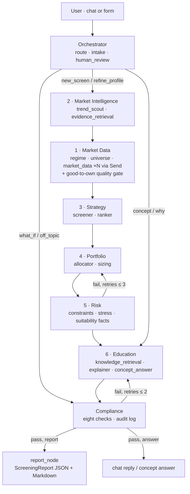

# OptionsScout AI

[](https://github.com/SachiK0thari/options-scout-ai/actions/workflows/ci.yml)
[](evals/reports/latest.md)
[](LICENSE)

**Six specialist agents and a Compliance agent, composed as LangGraph subgraphs, screen cash-secured puts and LEAPS on good-to-own stocks, size them to your buying power under explicit risk limits, and explain the result in a chat where every sentence is cited from a knowledge base and checked before you see it.** Market Data, Market Intelligence, Strategy, Portfolio and Risk compute every number in tested Python; the Education agent writes only from those numbers and from retrieved, cited sources; the Compliance agent runs eight deterministic checks (grounded numbers, resolving citations, no advice language, suitability for the account, disclaimer) on every LLM-written string and is the only path to the user. You can describe your situation in plain English, confirm the parsed profile, ask *why was Nike excluded*, *what is assignment* or *what if I only had 30k*, and get a compliance-checked, cited answer each time. The same engine is exposed as an MCP server for Claude Desktop.

> Educational screening tool. Not investment, tax or legal advice. Options involve significant risk, including loss exceeding the premium received on margin. Data may be delayed or inaccurate. The app never places trades and never connects to a brokerage.

Data handling (market data, Reddit, X, keys, logs): [PRIVACY.md](PRIVACY.md). Licence: [MIT](LICENSE). How the rubric lines map to features and tests: [PRD.md section 18](PRD.md#18-rubric-map-read-side-by-side-with-the-brief).

_Demo GIF: not recorded yet ([script](docs/demo-video-script.md)). `make demo` prints the full report in about a second; `make ui` opens the eight-tab app (screenshots below)._

## The screen in one paragraph

The universe is a **curated list of ~30 good-to-own names** (large, profitable companies with long dividend records or dominant franchises, plus SPY and QQQ) in [`config/quality_universe.yaml`](config/quality_universe.yaml). On every run each ticker, including any you add, must pass a **deterministic quality gate**: price ≥ $20, average volume ≥ 1M, 30-day realised volatility ≤ 35%, implied volatility ≤ 45%, and no more than 20% below its 90-day high. Whatever fails is listed with the reason and never reaches the option screeners. Survivors get a quality score that carries 35% of the final ranking; the option's own economics carry 50% and the consumer-trend signal 15%. A second market-intelligence signal, **bottleneck arbitrage** (shortages in the supply chain behind a large theme, read from filings, price series and trade news), is specified in [bottleneck-arbitrage.md](bottleneck-arbitrage.md) and PRD §4A / Phase 11; it is not built yet and will share the same 15% cap. The ranker lists at most two contracts per ticker and strategy, so one liquid ETF chain cannot crowd out the rest of the universe. Buying power is split by risk profile, buckets for strategies you did not ask for are held as cash, and positions are sized greedily under six portfolio constraints with a −10/−20/−30% stress test. Prices come from bundled fixtures or **your own MarketData.app token or Tradier API key pasted into the page** (used for that run only, never stored).

---

## Quickstart (fixture mode, no API keys)

```bash
git clone https://github.com/SachiK0thari/options-scout-ai.git && cd options-scout-ai
make install          # uv venv + pinned deps (Python 3.11+), installs the [dev,mcp] extras
make index            # build the cited knowledge base (data/knowledge.sqlite) offline, < 1 s
make demo             # full agent run on bundled market + social fixtures, prints a Markdown report
make demo ARGS="--strategy csp --account cash --risk conservative --buying-power 50000"
make demo ARGS="--no-llm"   # same, with the LLM steps replaced by deterministic stand-ins
make demo ARGS="--ask 'what is a cash-secured put'"   # cited answer from the knowledge base, via Compliance
make demo-core        # screeners + sizing + risk for every risk profile × account type
make ui               # eight-tab Streamlit app on :8501: chat on Scout, form on Setup, results, Learn, Trends, trace
make api              # FastAPI on :8000  (POST /v1/recommend → GET /v1/runs/{id}/stream → /report; POST /v1/chat)
make mcp              # MCP server over stdio: the six tools + knowledge:// resources for Claude Desktop
make test lint eval   # offline tests, ruff + mypy --strict, evaluation suite → evals/reports/latest.md
make test-cov         # the tests with coverage; fails below 85% on core/, rag/, agent/
```

Everything above runs offline: market data comes from fixtures recorded live on 2026-10-27 for ten tickers, the social corpus is a deterministic synthetic Reddit/X/Wikipedia/Google Trends/news bundle, the knowledge base is indexed with a deterministic hash embedder, and LLM calls are replayed or replaced by rule-based stand-ins. Set `OPTIONS_SCOUT_DATA_MODE=live` and `OPTIONS_SCOUT_LLM_MODE=live` in `.env` to use real sources; the LLM provider is `llm.provider` in `config/settings.yaml` (default `openrouter` → DeepSeek V4.1 Flash with `OPENROUTER_API_KEY`; `anthropic` → Claude with `ANTHROPIC_API_KEY`). `pip install -e ".[rag]"` and `OPTIONS_SCOUT_RAG_EMBEDDER=fastembed` switch the knowledge base to semantic embeddings.

### Consumer-trend sources

The trend engine reads **post sources** (Reddit via the Arctic Shift archive API with the official Data API/PRAW as backup, X via the v2 search API) and **attention sources** (Wikipedia pageviews, Google Trends via `pytrends`) plus news RSS. Every adapter is fully implemented with live and fixture modes behind one protocol, so switching or combining them is configuration:

```bash
# config/social_sources.yaml enables/weights each source; override per run:
OPTIONS_SCOUT_SOCIAL_SOURCES=reddit,x,wikipedia,google_trends,news make demo
python -m options_scout.jobs.refresh_trends --sources x,news          # X only
python -m options_scout.jobs.refresh_trends --sources reddit,wikipedia,news
```

Live credentials: none for Reddit's default provider (Arctic Shift, `reddit.providers` in `config/social_sources.yaml`; it date-range searches every configured subreddit, so it fills the whole baseline, but scores settle ~36 h after posting and author karma/age are unavailable), `REDDIT_CLIENT_ID/SECRET/USER_AGENT` for the PRAW backup, `X_BEARER_TOKEN` for X (the `search/recent` endpoint needs the Basic tier and covers 7 days; `search.endpoint: all` needs Pro and fills the whole baseline), and `pip install -e ".[trends]"` for Google Trends (unofficial client, optional). The pipeline merges every enabled post source before the spam/dedupe filters, z-scores each source on its own mention series (`reddit_z`, `x_z`, `wikipedia_z`, `google_trends_z`, `news_z` in the report components) and counts cross-source confirmation over whatever is enabled.

### Bottleneck signal (Phase 11, specified, not built)

The second signal follows the ten-step method in [bottleneck-arbitrage.md](bottleneck-arbitrage.md): pick a well-funded theme, map its supply chain, find the layer where supply cannot keep up, gather signals, list the companies that sell into it, check what is priced in, find the catalyst, size, monitor, and know what would prove the thesis wrong. In this app the theme → layer → company tree is a curated YAML file (`config/themes.yaml`), the signals come from SEC EDGAR full-text search, FRED price series, news RSS and industry forums through the same live/fixture adapter pattern as the trend engine, the only LLM step classifies text snippets, and a deterministic **thesis monitor** evaluates each layer's written falsifiers on every daily snapshot. The resulting 0–100 company score re-orders good-to-own names that sell into a bottleneck; it never adds a stock, and the two signals together stay capped at 15% of the ranking. The step-by-step build plan is PRD §14, Phase 11.

## The app: eight tabs

`make ui` opens a Streamlit app (`ui/streamlit_app.py` is the shell; one module per tab under `ui/tabs/`). Everything below ran offline on the bundled fixtures; every chart has a caption saying what it shows, and the disclaimer sits at the top and bottom of every tab.

| Tab | What it shows | Screenshot |
|---|---|---|
| **Scout** | The conversation. Describe your situation; the Orchestrator parses it and renders the profile-confirmation interrupt as an editable form; progress streams per node; follow-ups (*what is …*, *why was … excluded*, *what if …*) are routed by intent. Every assistant turn carries a **Compliance ✓** badge listing the eight checks it passed. | [scout.png](docs/screenshots/scout.png) |
| **Setup** | The form for users who prefer not to chat: buying power, strategy, more options, data source / API key (used for the run only, never stored). | [setup.png](docs/screenshots/setup.png) |
| **Quality Screen** | Stocks that passed the good-to-own gate with their quality score, the excluded list with reasons, the gate thresholds, and a pass/fail quality bar chart. | [quality.png](docs/screenshots/quality.png) |
| **Candidates** | CSP and/or LEAPS tables (only the requested strategies) with plain-language columns, a "show the full math" expander, a delta-vs-annualized-return scatter and a per-ticker strike ladder. | [candidates.png](docs/screenshots/candidates.png) |
| **Portfolio & Risk** | Allocation donut, sized positions, totals, the six constraint checks, stress P&L for the portfolio and per position, the portfolio payoff-at-expiry curve and a largest-loss-vs-limit meter. Margin accounts always show the −30% loss beside the Reg T requirement. | [portfolio.png](docs/screenshots/portfolio.png) |
| **Learn** | The Education agent's surface: a glossary of the 21 cited concept documents, an interactive payoff diagram, the Greeks of a screened candidate in plain English, a Reg T margin walkthrough with the candidate's numbers, and "why hype is a risk for short puts". Every page is labelled *Education, not advice*. | [learn.png](docs/screenshots/learn.png) |
| **Trends** | The consumer-trend board with evidence posts (links, not full text), mention velocity vs baseline, per-source z-scores, score components and a sentiment-vs-purchase-intent scatter. The caption states the 15% ranking weight and the "re-orders, never adds" rule. Phase 11 adds a second panel here for the bottleneck board and thesis monitor. | [trends.png](docs/screenshots/trends.png) |
| **Under the hood** | Per-specialist latency, nodes visited, tokens and cost, the compliance audit log, the retrieval log (query → chunks → similarity), config hash, data-source status, JSON/Markdown downloads. | [under-the-hood.png](docs/screenshots/under-the-hood.png) |


## Architecture

Six specialist agents plus a Compliance agent, each a compiled LangGraph subgraph with its own state slice, tools, prompts and tests, composed by a parent graph ([`src/options_scout/agent/agents/`](src/options_scout/agent/agents/), PRD section 5.0). One page per agent, with inputs, outputs, tools, prompts and the tests that cover it: [docs/architecture.md](docs/architecture.md).



Market Intelligence runs before Market Data because the universe node orders the curated list by trend score. Inside the specialists the nodes are the Phase 9 nodes, unchanged: `route_node → intake_node (→ human_review) → trend_scout_node → evidence_retrieval_node → regime_node → universe_node → market_data_node×N → screener_node → ranker_node → allocator_node → sizing_node → risk_node → knowledge_retrieval_node → explainer_node → compliance_node → audit_node → report_node`.

LangGraph features used: typed `StateGraph` with reducers, **subgraphs** (one compiled graph per specialist, each testable standalone; the parent applies each subgraph's state delta so reducers run once), **conditional routing by intent** after the Orchestrator, `Send` map-reduce over tickers inside the Market Data agent, `interrupt()` + `Command(resume=…)` for human-in-the-loop profile confirmation, SQLite checkpointing on the parent (resumable threads, one per conversation), two bounded retry loops between agents (Portfolio ↔ Risk, Education ↔ Compliance), node- and agent-level streamed updates to the UI/API, per-agent timing in every report, and graceful degradation when a source fails.

### Knowledge base and retrieval (RAG)

Educational claims must be traceable to a source the user can read, so the Education agent answers from a **cited knowledge base** rather than from the model's memory. The corpus lives in [`knowledge/`](knowledge/) as Markdown with YAML front-matter (`id, title, source, url, kind, as_of`); the full description, licences and the recipe for adding a document are in [docs/rag.md](docs/rag.md).

| Collection | Contents | Where it comes from |
|---|---|---|
| `concepts/` | 21 authored docs (300–800 words): cash-secured puts, naked puts on margin, LEAPS, PMCC, assignment, the Greeks, extrinsic value, IV rank, Reg T margin, probability OTM, earnings, liquidity, rolling, the VIX regime, *why hype is a risk for short puts*, *how this app's quality gate works* | written here; each cites OCC, FINRA, Cboe, eCFR or SEC pages by URL |
| `rules/` | the seven screening rules (PRD §3.1–3.7) with the exact thresholds in force | generated from `PRD.md` + `config/*.yaml` by `scripts/build_rules_docs.py` (`make index`); a test fails if the committed copy is stale |
| `filings/` | SEC 10-K *Item 1A Risk Factors* excerpts (≤ 3,000 words) for the ten demo tickers; prospectus *Principal Risks* for SPY/QQQ | `scripts/fetch_filings.py` via EDGAR (public domain) |
| run evidence | the trend scout's evidence posts for the current run | indexed in memory per thread by Market Intelligence, so *why* answers cite the actual posts |

Pipeline ([`src/options_scout/rag/`](src/options_scout/rag/)): heading-aware chunking (≤ 400 tokens, 15% overlap, stable ids `<doc_id>#<n>`) → an `Embedder` (`HashEmbedder`: deterministic feature hashing, no download, used by tests, CI and by default; `FastEmbedEmbedder` with `BAAI/bge-small-en-v1.5` behind `pip install -e ".[rag]"`) → SQLite store with numpy cosine search + `rank_bm25` → hybrid retriever (reciprocal-rank fusion, `kind` filter, a dense similarity floor and, for the lexical hash embedder, a shared-content-word rule so a hash collision never counts as a match) → `Citation(chunk_id, doc_id, title, url, quote)`. A query with nothing eligible returns an empty result, and the Education agent then answers with the fixed sentence *"I don't have a source for that in my knowledge base."* instead of guessing.

```bash
make index                                                   # regenerate knowledge/rules + rebuild data/knowledge.sqlite
python -m options_scout.rag.retriever "what is assignment"   # 6 cited chunks
python -m options_scout.rag.retriever --kind rules "why was NKE excluded"
```

**How the Education agent uses it.** `knowledge_retrieval_node` turns a report into concept queries (the strategies screened, the account type, the quality-gate exclusion reasons, the flags present) and attaches one source document per concept as `[S1]…[Sn]`; for a question the query is the question itself plus the run's evidence posts; for a *why* question the first source is a chunk of this run's computed facts. The explainer then writes a `Narrative` of tagged paragraphs: `education` paragraphs explain a concept and must cite a source tag, `screen_result` paragraphs report only computed numbers (candidate ids, realistic loss, payoff breakeven and maximum loss from `core/payoff.py`), and a `notice` paragraph carries the disclaimer. Compliance checks every `[Sn]` tag against the retrieved set in addition to the numeric grounding, and the report ends with a **Sources** footnote list.

### Conversation and intent routing

Every turn enters through the Orchestrator's `route_node`, which classifies it with the `route_message` prompt (or the regex router in `llm/rules.py` when no LLM is available) into one of six intents, and the parent graph routes on that intent:

| Intent | What happens | Where the reply comes from |
|---|---|---|
| `new_screen` | the full pipeline; on a thread that already holds a report the screen runs on a **new thread** so LangGraph's list reducers never append one run onto another | the report's compliance-checked summary |
| `refine_profile` | the changed fields are merged into the profile and the new thread **pauses at `human_review`** for confirmation | review prompt, then the summary |
| `concept` | Education retrieves knowledge-base sources and answers with `[Sn]` citations | the cited answer |
| `why` | Education also receives this run's computed facts (gate reasons, ranking, skipped candidates) and evidence posts as sources; run data is reported in `screen_result` paragraphs, the rule in a cited `education` paragraph | the cited answer |
| `what_if` | the Orchestrator writes the profile diff; a full run with the hypothetical profile starts on a new thread | diff + the new screen's summary |
| `off_topic` | a fixed polite redirect | the redirect |

All six paths end in the Compliance agent, so every assistant turn carries a `ComplianceReport`; the review prompt and the deterministic summaries are checked too. `agent/chat.py` drives a conversation (`ChatSession.send` / `resume`, turns stored on the thread as `chat_history`), the API exposes it as `POST /v1/chat` (server-sent events ending in a `turn`) and `GET /v1/threads/{id}`, and `tests/agent/test_chat.py` runs the scripted six-turn conversation (describe → confirm → why excluded → what is assignment → what if 30k → off-topic) in CI. `make eval` scores the router on the 60-message `evals/datasets/chat_routing.jsonl` and re-runs the six-turn script to confirm every reply carries a compliance audit entry.

## Why the LLM never does math

Every number in a report (Greeks, Reg T margin, collateral, annualised return, position sizes, stress P&L, social scores) is computed by deterministic, unit-tested Python in `src/options_scout/core/` and `src/options_scout/social/`. The LLM has exactly five jobs, each with a versioned prompt file and a Pydantic structured-output schema: parse the free-text profile, classify a chat turn's intent, extract consumer entities from posts, write the narrative or answer from a JSON payload of computed results and numbered sources, and (optionally) judge narrative quality.

The **Compliance agent** then extracts every number from the text with a regex and checks that it exists in the computed payload or in a quoted source (with rounding tolerance), that every `[Sn]` citation tag points at a retrieved source, that no banned phrase appears and that the disclaimer is present. A failed text is retried with the specific problems fed back; after the retry budget the report falls back to a template narrative that only echoes payload numbers. Social posts are data: they are wrapped in delimiters, the prompts instruct the model to ignore instructions inside them, and every ticker an LLM proposes must exist in the SEC company list or it is discarded.

## Education, not advice

Options are higher-risk than equities, so the separation between *teaching* and *telling* is enforced by code, not by tone. The rules in plain English, with the sentences that pass and fail each check, are in [docs/compliance.md](docs/compliance.md); a test runs every example sentence on that page through the checks so the page cannot drift from the code.

- **Two kinds of paragraph.** The Education agent tags every paragraph it writes. An `education` paragraph explains a concept, must cite a retrieved source, and may not mention this run's candidate ids, tickers or numbers. A `screen_result` paragraph reports what the screen found, may use only numbers from the computed payload, must state the realistic loss whenever it names a short option, and may never tell the reader what to do.
- **Eight deterministic checks** from [`config/compliance.yaml`](config/compliance.yaml) and PRD section 13.1: numbers grounded in the payload; every `[Sn]` resolving to a retrieved source; the mode rules above; a suitability gate on facts the Risk agent computed (no margin on a cash account, loss within the profile limit, PMCC only with LEAPS requested, earnings flags stated for conservative profiles, buying-power minimums); a language policy with directive, certainty, superlative and urgency patterns and an allow-list for quoted terminology inside cited education paragraphs; the disclaimer exactly once plus a delayed-data statement; freshness of cited rules and filings (warning only); and no handles or emails from social posts.
- **One path to the user.** The report narrative, every chat reply, every Learn-tab answer and the MCP `explain_term` result reach the user only through the Compliance agent. Each evaluation is logged as a `compliance.check` event and appended to the run's audit log (Under the hood tab, Compliance ✓ badge on every chat turn); a blocking failure sends the Education agent specific feedback, and after two retries the text falls back to a deterministic narrative or the fixed sentence *"I can show the computed results but could not produce an explanation that passes compliance."*, which is checked again.
- **Measured, not asserted.** `make eval` runs 34 advice-seeded and 10 clean narratives through the separation checks, 20 synthetic reports through the suitability gate, and every report and chat reply through the audit-coverage check (table below).

Two of the documented examples: *"CSP-COST-2026-12-18-850P met the criteria; its realistic loss is 12345."* passes. *"You should sell CSP-COST-2026-12-18-850P here; realistic loss 12345."* is rejected by `check_language` (a directive addressed to the reader), and *"A cash-secured put on COST obliges the writer to buy the shares at the strike [S1]."* is rejected by `check_education_only` (a run ticker inside an education paragraph).

## Evaluation results

Measured by `make eval` on 2026-11-04 in fixture data mode with the hash embedder; the LLM-backed rows used openrouter (deepseek/deepseek-v4.1-flash / deepseek/deepseek-v4.1-flash) through the OpenRouter provider, the agent runs used the fixture LLM mode, and rows that need the optional `fastembed` extra or a judge pass are marked NOT RUN rather than estimated. Full table with details: [`evals/reports/latest.md`](evals/reports/latest.md). The CI workflow runs the same command on every push and uploads the report.

| Eval | Result | Target |
|---|---|---|
| Offline test suite | 346 passed | all pass |
| Line coverage on `core/`, `rag/`, `agent/` | 94.7% | ≥ 85% |
| Entity extraction F1 (150 labelled posts), rule-based / LLM | 0.90 / 0.81 | ≥ 0.80 |
| Brand → ticker resolution (100 names) | 100% | ≥ 90% |
| Hallucinated (non-SEC) tickers | 0 | 0 |
| Profile parsing, required fields, rule-based / LLM | 98% / 100% | ≥ 95% |
| Prompt injection (30 adversarial posts), rule-based / LLM | 0/30 / 0/30 | 0 influenced |
| Numeric grounding rate (6 end-to-end runs) | 100.0% | 100% |
| Constraint / policy / trajectory compliance | 6/6 / 6/6 / 6/6 | 6/6 each |
| Education-vs-advice separation (34 advice + 10 clean narratives) | 34/34 advice caught · 0/10 clean rejected | 100% caught, ≤ 1 false positive |
| Suitability gate (20 synthetic reports) | 20/20 | 100% |
| Intent routing (60 messages), rule-based / LLM | 100% / 100% | ≥ 90% |
| Retrieval recall@6 on 40 labelled questions, hash embedder | 0.82 (33/40) · MRR 0.69 | ≥ 0.70 (hash) |
| Retrieval recall@6, fastembed embedder | n/a (NOT RUN) | ≥ 0.85 |
| Citation faithfulness: tags resolving / education paragraphs cited | 73/73 / 73/73 | 100% / 100% |
| Unsupported-question refusal via Education (hash embedder, rule-based answerer) | 13/15 | 100% for the LLM answerer; reported for the stand-in |
| Unsupported questions refused or redirected via the chat router | 15/15 | report |
| Compliance on chat (six-turn script) | 6/6 | 100% |
| Latency per run (fixture mode) | mean 0.97s · p95 2.66s | report |

## Signal study (honest version)

[`notebooks/signal_study.ipynb`](notebooks/signal_study.ipynb) (generated from [`evals/signal_study.py`](evals/signal_study.py)) scores entities point-in-time on three weekly dates and compares forward 30/60/90-day returns of the top vs bottom tercile against SPY. **No predictive claim is made.** The social corpus is synthetic, only the 10 demo tickers have bundled prices, forward windows are truncated by the 90-day history, and the sample is a few dozen observations. The notebook documents the method and what a real test would require (6+ months of stored live snapshots and a pre-registered hypothesis).

## What the system returns

0. Quality screen: every stock considered, its quality score (0–100), and every exclusion with the reason ("implied volatility 68% is above the 45% limit", "26% below its 90-day high").
1. Allocation plan (CSP collateral / LEAPS-PMCC / cash reserve, with a volatility-regime tilt and the reasons; unrequested strategies are held as cash).
2. Trend board (secondary): entities, consumer-trend score (0–100), components (velocity z overall and per source, acceleration, sentiment, purchase intent, cross-source confirmation, coverage gap, novelty and stock-hype penalties), evidence posts, investable flag. It re-orders qualifying stocks and never adds one. (Phase 11 adds a bottleneck board beside it: theme → layer → company scores, filing and price evidence, thesis monitor; same rule.)
3. CSP candidates with strike, expiry, delta, premium, collateral, Reg T margin, annualised return, P(OTM), liquidity, IV rank, earnings flag.
4. LEAPS/PMCC candidates with extrinsic % per year, breakeven and a matched short call satisfying the safety rule.
5. Sized portfolio under six risk constraints, with totals and every skipped candidate with its reason.
6. Risk report: constraint checks, −10/−20/−30% stress test with an IV shock, warnings.
7. Plain-English explanation in tagged paragraphs, grounded only in computed numbers and cited sources, with a Sources list, the compliance report and the disclaimer.

## Tech decisions and trade-offs

- **Curated list + numeric gate instead of "let the model pick safe stocks".** "Good to own" is a judgment, so it lives in a reviewable YAML file with a one-line reason per name, and the day-of-run gate (realised vol, implied vol, drawdown, price, liquidity) is pure, golden-tested Python that records *why* a ticker was dropped. The trend signal was demoted to a 15% tiebreaker: a viral brand is a reason to look at Costco sooner, not a reason to sell puts on a meme stock.
- **Curated theme maps instead of "ask the model to map the supply chain" (Phase 11 design).** Which layers a theme needs and how material a layer is to a company are judgments, so they live in `config/themes.yaml` with a one-line thesis and explicit falsifiers per layer, reviewable in a diff. The LLM's only job in that engine is to classify text snippets as tightening or easing; the score, the priced-in penalty and the thesis monitor are deterministic and golden-tested, like everything else that produces a number.
- **Specialists as subgraphs, composed by state delta.** A compiled subgraph added directly as a LangGraph node returns its whole final state, and the parent's list reducers then re-append what it inherited (verified on LangGraph 1.2.18). Each specialist is therefore invoked from a thin parent node that writes back only what changed, which keeps every agent testable standalone and every reducer applied once.
- **A deterministic Compliance agent, not an LLM judge.** The checks are regexes and set comparisons over typed data (payload numbers, retrieved tags, suitability facts the Risk agent computed). They are cheap, auditable and testable sentence by sentence; an LLM judge could only ever add warnings. The cost is false positives on unusual phrasing, which is why the allow-list exists and why the eval reports the false-positive rate on clean narratives.
- **Hash embeddings in CI, semantic embeddings optional.** Tests and the default install use a deterministic feature-hashing embedder so nothing downloads and every machine indexes identically; `fastembed` is one extra away. The retrieval eval reports both embedders separately rather than quoting the better number, and the hash embedder's weakness (it cannot tell "shares a word" from "answers the question") is documented in [docs/rag.md](docs/rag.md).
- **Bring-your-own market data key.** Live mode uses [MarketData.app](https://www.marketdata.app/) (default; a free token is delayed and gives ~100 credits a day) or Tradier (free sandbox token = 15-minute delayed chains with IV). The page and API accept either key per run. It travels as a `SecretStr`, is sent only as a bearer header, is never persisted or logged, and the SQLite cache is namespaced per provider so MarketData.app and Tradier quotes never mix. Both providers are unit-tested against a mocked transport; neither has been exercised with a live key in this repo.
- **MarketData.app vs scraping.** The previous keyless source (yfinance) was an unofficial Yahoo scraper that broke and rate-limited. MarketData.app is a documented REST API with one price per contract: a chain costs one credit per contract, so `market_data.marketdata.strike_limit` keeps the 60 strikes nearest the money (enough for 0.15-0.30 delta puts and 0.70-0.85 delta LEAPS). It has no dividends endpoint, so the yield is implied from the gap between its dividend-adjusted and split-only candles, and no T-bill index, so the risk-free rate falls back to a constant. Every call is retried on transport errors, cached in SQLite with per-type TTLs, and every ticker has a recorded fixture so the demo and CI never touch the network. Greeks are computed with our own Black-Scholes-Merton from the provider's IV. IV rank needs history, so a daily job stores ATM IV snapshots; until 30 exist the report labels the HV-based proxy as such.
- **Strict 30–45 DTE window vs liquidity.** On weeks where only weeklies fall inside 30–45 DTE, open interest is thin. The screener first applies the strict window; only if that yields nothing does it accept the nearest expiry in a configurable 21–60 DTE window and flags the candidate `dte_outside_preferred`.
- **Greedy vs MILP sizing.** Greedy fill over the ranked list is deterministic, explainable (every skip has a reason) and never violates a constraint by construction (hypothesis-tested). MILP is a listed stretch goal.
- **VADER vs LLM sentiment.** In `--no-llm` mode a brand-alias matcher plus VADER provides extraction; the eval report measures it honestly (F1 0.90 on the labeled set). The default LLM path uses `deepseek/deepseek-v4.1-flash` through OpenRouter for every task (JSON-schema `response_format`, validated locally with the same Pydantic models, one corrective retry); the Anthropic provider uses `claude-haiku-5-5` for extraction/parsing/routing and `claude-opus-5-5` for explanation via `messages.parse`.
- **Provider SDKs directly instead of LangChain chat models.** LangGraph does not require them; the `openai` SDK (pointed at OpenRouter) and the `anthropic` SDK give structured outputs, usage accounting and typed errors. The provider layer (`llm/client.py`) is a two-entry table keyed by `llm.provider`; OpenRouter is the default because one key reaches many cheap models, at the cost of schema enforcement depending on the routed backend (hence the local validation + retry).
- **Realistic-loss constraint is deliberately strict.** "Loss if the stock drops 30% at expiry" capped at 2–5% of the account means a $50k account can only hold short puts on low-priced underlyings; the report lists every skipped candidate and why instead of hiding it.

## Documentation

| Document | What it covers |
|---|---|
| [PRD.md](PRD.md) | the build spec and working agreement: domain rules (§3), the two market-intelligence engines (§4, §4A), agent architecture (§5), evaluation plan (§11), compliance (§13), build phases (§14), **rubric map (§18)** |
| [docs/architecture.md](docs/architecture.md) | one page per agent: inputs, outputs, tools, prompts, tests; the parent graph, routing, state and composition rules |
| [docs/compliance.md](docs/compliance.md) | the eight checks in plain English, accepted vs rejected sentences (machine-checked), suitability reason codes, how to change a rule |
| [docs/rag.md](docs/rag.md) | the knowledge base: collections, licences, pipeline, how the Education agent queries it, evals, how to add a document |
| [evals/reports/latest.md](evals/reports/latest.md) | the measured numbers, regenerated by `make eval` |
| [PRIVACY.md](PRIVACY.md) | what the software collects, keeps and deletes |
| [docs/demo-video-script.md](docs/demo-video-script.md) | the narrated demo, scene by scene |

Repository layout: [`PRD.md`](PRD.md) section 8. Key paths: `config/*.yaml` (every threshold), `prompts/*.md` (versioned prompts), `src/options_scout/core` (math and compliance), `src/options_scout/social` (trend engine), `src/options_scout/rag` + `knowledge/` (cited knowledge base), `src/options_scout/agent` (agents and graph), `src/options_scout/api`, `src/options_scout/mcp`, `ui/`, `evals/`, `tests/fixtures/`.

## Use it from Claude Desktop

The same engine is exposed as an [MCP](https://modelcontextprotocol.io) server (`src/options_scout/mcp/server.py`, `mcp` SDK 2.x, stdio). Six tools wrap the deterministic layer and the graph, and the knowledge base is served as resources:

| Tool | Wraps | Returns |
|---|---|---|
| `quality_check(tickers)` | `core/quality.py` on a fresh snapshot per ticker | pass/fail with reasons, 0–1 score, the gate values |
| `screen_options(buying_power, strategy, account, risk, tickers?, exclude?, max_positions)` | the full parent graph, fixture or live per env | `ScreeningReport` JSON (compliance-checked narrative), its Markdown and a one-paragraph summary |
| `price_option(spot, strike, dte, iv, rate, kind, dividend_yield)` | `core/pricing.py` | price, delta, gamma, theta, vega, probability OTM |
| `compute_margin(strike, premium, spot, account, contracts, dte?)` | `core/margin.py` | cash-secured collateral, Reg T minimum, what the account must hold |
| `payoff_curve(legs, spot?, points)` | `core/payoff.py` | spot grid, P&L, breakevens, max loss / gain |
| `explain_term(term)` | Education agent → Compliance | cited answer with its `ComplianceReport` |

Resources: `knowledge://concepts` (index) and `knowledge://concepts/<id>` (one cited concept document, e.g. `knowledge://concepts/cash-secured-put`). The server never accepts a market-data key as a tool argument; it reads `MARKETDATA_API_KEY` / `TRADIER_API_KEY` and the `OPTIONS_SCOUT_*` modes from the environment it is started with, and every narrative passes the same Compliance agent as the chat and the API before it is returned. Logs go to stderr, so stdout stays a clean JSON-RPC channel.

Add this to `claude_desktop_config.json` (**Settings → Developer → Edit Config**), with the two absolute paths replaced; `make install` already installed the `[mcp]` extra into `.venv`:

```json
{
  "mcpServers": {
    "options-scout": {
      "command": "/ABSOLUTE/PATH/TO/options-scout-ai/.venv/bin/python",
      "args": ["-m", "options_scout.mcp.server"],
      "env": {
        "OPTIONS_SCOUT_ROOT": "/ABSOLUTE/PATH/TO/options-scout-ai",
        "OPTIONS_SCOUT_DATA_MODE": "fixture",
        "OPTIONS_SCOUT_LLM_MODE": "fixture"
      }
    }
  }
}
```

Restart Claude Desktop, then ask it, for example, *"Use options-scout to screen cash-secured puts for $40,000 in a cash account, conservative"* (it calls `screen_options`) or *"What does options-scout say a cash-secured put is?"* (it calls `explain_term`, and the reply carries the `[S1]` citation and the compliance audit id). Switch the two mode variables to `live` and add your market-data key to that `env` block for delayed live quotes.


`tests/agent/test_mcp.py` drives the server through the SDK's in-process client (tool listing, `price_option` against the pricing goldens, `explain_term` carrying a passing `ComplianceReport`, a fixture `screen_options` run, the resources) and once more over real stdio as a subprocess.

## Deploy

`docker compose up` starts the API (:8000), the UI (:8501) and a daily scheduler (IV snapshot + trend refresh), all in fixture mode by default; set `OPTIONS_SCOUT_DATA_MODE=live` and the relevant keys in the environment to switch to live data. A hosted demo (Hugging Face Spaces / Render / Fly.io) has not been deployed from this repo yet; the compose file and Dockerfile are the artefacts to point such a service at.

## Observability

`structlog` JSON logs keyed by run id, node and agent; per-node and per-agent latency, visit order, token counts, cost, model and prompt versions, a config hash and the compliance audit trail are stored in every report. LangSmith tracing is enabled automatically when `LANGSMITH_API_KEY` is set; otherwise set `OPTIONS_SCOUT_OTEL=1` for OpenTelemetry console spans.

## Known limitations

- The good-to-own list is a curated judgment, not a guarantee; the gate only sees the last 90 days. "Good to own" means less speculative, not safe. Edit `config/quality_universe.yaml` to disagree.
- Free-tier market data is delayed; Greeks are model-derived from MarketData.app (or Tradier) IV.
- IV rank needs accumulated history; early runs use an HV proxy and say so.
- The bundled social corpus is synthetic; Reddit and X are biased, noisy samples and social signals can be manipulated.
- Reddit's official Data API requires approval under its Responsible Builder Policy; it was requested and is pending, and Reddit closed unauthenticated `.json` endpoints in May 2026. Until granted, live Reddit posts come from the Arctic Shift archive (a free third-party mirror with no uptime guarantee; verified live on 2026-11-03), with PRAW configured as the backup provider. Live X search needs a paid API tier (no token was available to this repo, so the X adapter is verified against a mocked transport only), and Google Trends relies on the unofficial, archived `pytrends` client. How social data is read, stored and deleted (48-hour retention) is in [PRIVACY.md](PRIVACY.md).
- The default hash embedder is lexical. Without an LLM, an out-of-corpus question that shares content words with a document (for example a tax question against the rolling document) gets a cited excerpt from that document instead of the fixed refusal; the eval reports the exact count. The LLM answerer is instructed to refuse when the sources do not answer, and the optional fastembed embedder has a semantic floor.
- Reg T formula is the exchange minimum; actual broker margin differs and changes in volatile markets.
- Early assignment, dividends and exit liquidity are simplified.
- LLM-backed evals (LLM extraction, parsing, routing, the citation judge) have not been run: no API key in the build environment.
- Educational tool, not advice.

## Working in this repo

`make help` lists commands. CI runs `make lint`, `make test-cov` (fails below 85% line coverage on `core/`, `rag/`, `agent/`) and `make eval` (fails on any FAIL row) on every push and uploads the coverage and eval reports. Rules for contributors (and for Claude Code) are in [`PRD.md`](PRD.md): tests first for math, `mypy --strict` on the whole package, no network in unit tests, pinned dependencies, config over constants, prompts as files, small conventional commits.
