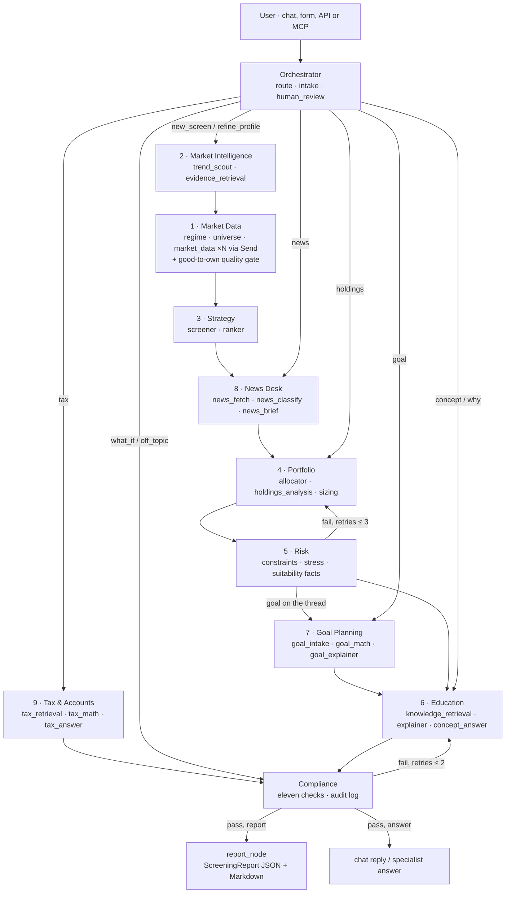

# Architecture: one page per agent

OptionsScout AI is a LangGraph application made of **eleven compiled subgraphs** (an Orchestrator, nine specialist agents and a Compliance agent) composed by one parent graph in [`src/options_scout/agent/graph.py`](../src/options_scout/agent/graph.py). Each agent lives in its own file under [`src/options_scout/agent/agents/`](../src/options_scout/agent/agents/), owns one slice of the typed state ([`agent/state.py`](../src/options_scout/agent/state.py)), calls only deterministic tools in `core/`, `social/`, `data/` and `rag/`, and reads its prompts from [`prompts/`](../prompts/). This is the technical design document the capstone brief asks for: system architecture decisions, the agent communication protocol, the per-agent reference (inputs, outputs, tools, prompts, tests) and performance considerations. Read it next to [compliance.md](compliance.md) (the rules every LLM-written string must pass), [rag.md](rag.md) (where the citations come from) and [brief-mapping.md](brief-mapping.md) (how the brief's six agents and prescribed layout map onto this repository).

Three rules hold everywhere:

1. **The LLM never does math.** Every number in a report or a reply is computed by unit-tested Python. The LLM parses a profile, a goal or a holdings list, classifies a chat turn or a headline, extracts entities from posts, and writes prose from a JSON payload of computed results and numbered sources. Nothing else.
2. **Every LLM-written string reaches the user only through the Compliance agent.** There is no edge from any writer to the user. The report narrative, every chat reply, every concept, goal, holdings, news and tax answer and every MCP tool that returns text (`explain_term`, `plan_goal`, `analyze_holdings`, `news_brief`, `explain_tax_term`, the `screen_options` narrative) carry a `ComplianceReport` and an audit id.
3. **Specialists talk only through typed state.** No specialist imports another specialist's module. Shared logic lives in `core/`, `social/`, `rag/`.

## The parent graph

**Execution order of a screen.** `orchestrator → market_intelligence → market_data → strategy → news_desk → portfolio ⇄ risk (→ goal_planning when the thread carries a goal) → education ⇄ compliance → report_node`. Market Intelligence runs *before* Market Data because the universe node orders the curated list by trend score, so the trend board is an input to the universe. News Desk runs *after* Strategy because its calendar flags (earnings inside the option's life, ex-dividend before a short call's expiry) are attached to candidates, which do not exist earlier. Goal Planning runs *after* Risk because it needs the sized portfolio's yield. The numbering (1 Market Data, 2 Market Intelligence, …) follows the rubric and the brief, not the run order (`AGENT_ORDER` in `graph.py`).

**Routing by intent.** After the Orchestrator the parent graph reads `state.intent`, one of ten:

| Intent | Path | Reply |
|---|---|---|
| `new_screen`, `refine_profile` | the full pipeline (on a thread that already holds a report, the session starts the screen on a new thread; LangGraph's list reducers would otherwise append one run onto another) | compliance-checked summary of the report |
| `concept` | Education → Compliance | cited answer |
| `why` | Education (with this run's computed facts and evidence posts as sources) → Compliance | cited answer |
| `goal` | Goal Planning → Compliance | verdict, levers, projection, FIRE plan or a clarification |
| `holdings` | Portfolio (holdings path) → Compliance | the holdings analysis; holdings stay on the thread and enable the seventh sizing constraint in later screens |
| `news` | News Desk → Compliance | per-ticker briefs and calendar flags |
| `tax` | Tax & Accounts → Compliance | cited tax answer with the illustrative facts |
| `what_if` | Orchestrator writes the profile diff → Compliance; the session then runs the hypothetical screen on a new thread | diff + new summary |
| `off_topic` | Orchestrator's fixed redirect → Compliance | the redirect |

A **pinned turn** (`agent/graph.py::ask_specialist`, used by the four specialist MCP tools) carries no chat message and exactly one of `goal_text`, `holdings_text`, `news_text`, `tax_text`; `route_node` does not classify it, so `explain_tax_term("wash sale")` always reaches the Tax & Accounts agent, on a new thread or on a finished screen's thread.

**Composition.** A compiled subgraph added directly as a node returns its whole final state, and the parent's reducers then re-append the lists it inherited. [`agents/base.py`](../src/options_scout/agent/agents/base.py) therefore invokes each subgraph and hands back only the **state delta**, so every reducer applies exactly once. Interrupts raised inside a subgraph propagate to the parent; `Send` fan-outs stay inside their subgraph; the subgraph inherits the parent's checkpointer and thread, so a paused Orchestrator resumes in place.

**State.** `AgentState` is one flat `TypedDict` (LangGraph's channel schema) with reducers on the fan-out keys (`market_data`, `quality`, `candidates`, `pmcc_pairs`, `errors`, `audit_log`, …). The eleven `*Slice` Pydantic models (`OrchestratorSlice`, `MarketDataSlice`, `MarketIntelligenceSlice`, `StrategySlice`, `NewsDeskSlice`, `PortfolioSlice`, `RiskSlice`, `GoalPlanningSlice`, `TaxSlice`, `EducationSlice`, `ComplianceSlice`, plus the shared `RunSlice` bookkeeping) partition the keys by owner; `tests/agent/test_agents.py` asserts that the slices cover the state exactly once and that each agent, run standalone on a fixture state, fills only its own slice plus `RunSlice`.

**Checkpointing and streaming.** The parent compiles with an SQLite checkpointer (`data/checkpoints.sqlite`) in the UI and API and an in-memory one in tests and the MCP server. `stream_run` yields `{node_name: partial_state}` updates from inside the specialists plus one `{agent_name: delta}` when a specialist finishes; the UI's progress box and the API's server-sent events consume the same stream. `interrupt()` in `human_review` pauses the thread; `Command(resume=…)` continues it. A thread is one conversation: `chat_history` (every turn with its `ComplianceReport`), the profile, the last report, holdings and goal persist on it, and `next_turn_state` clears only the per-turn keys (message, intent, texts, answer, the explainer retry counter) before each turn.

**Observability.** `observability.py` wraps every node (`node_done` events with latency) and every agent (`agent.start` / `agent.end`). The report's `RunMetadata` records nodes and agents visited, per-node and per-agent latency, token usage, cost, model and prompt versions and a config hash. The Compliance agent logs one `compliance.check` event per evaluation. LangSmith tracing is enabled when `LANGSMITH_API_KEY` is set; `OPTIONS_SCOUT_OTEL=1` emits OpenTelemetry console spans.

## Agent communication protocol

The brief asks for the protocol in so many words, so here it is as rules, each enforced by a test:

1. **Shared typed state, no direct calls.** An agent reads the keys its slice declares as inputs and writes only the keys it owns (plus `RunSlice` bookkeeping: `errors`, `nodes_visited`, latencies, `token_usage`, `data_source_status`). Writes are Pydantic models, never free-form dicts, so a downstream agent can rely on the shape. (`tests/agent/test_agents.py::test_each_specialist_runs_standalone_and_fills_only_its_slice`)
2. **Ordering by data dependency.** The parent graph's edges encode who needs what: Strategy needs `market_data`, News Desk needs `candidates`, Portfolio needs `ranked`, Risk needs `portfolio`, Goal Planning needs `risk` and `portfolio`, Education needs every computed slice, Compliance needs the text, the payload, the sources and `suitability_facts`. Nothing is read before it is written. (`test_parent_graph_visits_agents_in_order_and_records_a_per_agent_trace`)
3. **Feedback travels as state, bounded by counters.** Risk tells Portfolio what failed through `risk.checks` and `retries["sizing"]` (≤ 3); Compliance tells a writer what to fix through `verifier_feedback` and `retries["explainer"]` (≤ 2). Each retry re-enters the agent at its writer, not at its retrieval or math. (`test_portfolio_agent_skips_the_allocator_on_a_sizing_retry`, `tests/agent/test_compliance_agent.py`)
4. **Facts are computed once, upstream.** Compliance never recomputes a suitability fact; it reads `SuitabilityFacts` the Risk agent wrote. Goal Planning never re-prices; it reads the sized portfolio's yield. The Tax agent never re-screens; it illustrates with the thread's candidates.
5. **Degradation is a value, not an exception.** A failing source writes a string to `errors` and a status to `data_source_status`; the next agent sees fewer tickers, an empty trend board or no headlines, and the report says so. (`tests/agent/test_graph_e2e.py`, the graceful-degradation eval row)
6. **Text is not trusted until Compliance says so.** Any node that produces `narrative` or `answer` is followed by the Compliance agent; `answer_question`, `ask_specialist`, `GET /v1/runs/{id}/report`, the chat session and every MCP tool refuse to return text whose audit log did not grow in that turn.

---

## 0 · Orchestrator (`agents/orchestrator.py`)

**Purpose.** Turn whatever the user sent into a routed, typed request: classify the turn, parse a profile, confirm it with the user when required, and write the two deterministic replies (what-if diff, off-topic redirect) that need no specialist.

| | |
|---|---|
| **Nodes** | `route_node` → `intake_node` ⇄ `human_review`; `what_if_node`; `redirect_node` |
| **Reads** | `request_text`, `profile_override`, `message`, the specialist texts of a pinned turn, the current `profile` and `report` (routing context) |
| **Writes** (`OrchestratorSlice`) | `intent`, `question`, `goal_text`, `holdings_text`, `news_text`, `tax_text`, `handoff`, `what_if_profile`, `what_if_diff`, `parsed`, `profile` (including `knowledge_level`), `profile_complete`, `review_requested`; `answer` for what-if and off-topic replies |
| **Tools** | `nodes/route.py::apply_changes` / `profile_diff` (pure profile arithmetic), `pinned_intent`, `core/models.UserProfile` validation |
| **Prompts** | [`route_message.md`](../prompts/route_message.md) 1.3.0 → `RouteDecision(intent, question, profile_changes)` over the ten intents, with their boundaries against each other and a fixed tie-break order (off-topic, goal, holdings, news, tax); [`parse_profile.md`](../prompts/parse_profile.md) 1.2.0 → `ProfileParse` (structured output, temperature 0; parses the knowledge level). Rule-based fallbacks `rule_route` and `rule_parse_profile` in [`llm/rules.py`](../src/options_scout/llm/rules.py) run when no LLM is available |
| **Human in the loop** | `human_review` raises `interrupt()` with the parsed profile and the missing fields; the UI renders it as an editable form, the API as an `interrupt` event. A `refine_profile` turn sets `review_requested` so the review shows once even when the profile is complete |
| **Tests** | `tests/agent/test_chat.py` (every intent, the scripted seven-turn conversation, the 100-row routing dataset, pinned turns), `tests/agent/test_graph_e2e.py::test_interrupt_then_resume_with_sqlite_checkpointer`, `tests/agent/test_api.py::test_interrupt_and_resume_via_api`; evals: profile parsing (60 requests, incl. knowledge level), intent routing (100 messages, rule-based and LLM) |

## 1 · Market Data (`agents/market_data.py`)

**Purpose.** Everything the screeners need to know about the market today, with the good-to-own gate applied before any option is looked at.

| | |
|---|---|
| **Nodes** | `regime_node` → `universe_node` → `market_data_node` (one `Send` per ticker) |
| **Reads** | `profile` (watchlist, exclusions, max tickers), `social_scores` (ordering) |
| **Writes** (`MarketDataSlice`) | `regime` (VIX level and one-year percentile, risk-free rate, label and allocation tilt), `universe`, `market_data` (only tickers that passed the gate), `quality` (every ticker, passed or not, with reasons); `data_source_status`, `errors` |
| **Tools** | [`data/market.py`](../src/options_scout/data/market.py) (MarketData.app or Tradier live, recorded fixtures offline; cache with per-type TTLs, namespaced per provider; retries with backoff on transport errors and 5xx, an immediate error on 401 and 429), [`core/regime.py`](../src/options_scout/core/regime.py), [`core/volatility.py`](../src/options_scout/core/volatility.py) (HV30, IV rank or HV proxy), [`core/quality.py`](../src/options_scout/core/quality.py) (the gates and the 0–1 quality score), `nodes/universe.py::build_universe` (curated list ∪ watchlist − exclusions, ordered by trend score, capped) |
| **Prompts** | none |
| **Degradation** | a missing VIX falls back to neutral defaults with an error note; a ticker whose data fails is recorded in `errors` and skipped; a failing gate writes the ticker to `quality` with reasons and never to `market_data`, so screeners cannot see it |
| **Also feeds** | the **market overview strip** on the Quality Screen and Candidates tabs (`ui/compute.py::market_strip`): SPY, QQQ, VIX with percentile and regime, the 13-week T-bill, the provider and the data age read from the oldest quote's fetch time |
| **Tests** | `tests/unit/test_quality.py`, `test_market_fixture.py`, `test_marketdata_source.py`, `test_tradier_source.py`, `test_cache.py`, `test_volatility.py`; `tests/agent/test_graph_e2e.py::test_user_added_risky_ticker_is_excluded_by_quality_gate`; `tests/agent/test_learning_path.py` (the strip's data age in fixture and live-named modes); `tests/integration/test_market_live.py` (`make test-live`) |

## 2 · Market Intelligence (`agents/market_intelligence.py`)

**Purpose.** The two market-intelligence boards. The consumer-trend board: which brands people are talking about more than usual, resolved to tickers. The bottleneck board (Phase 11, PRD §4A): which supply-chain layers behind a well-funded theme are tightening, read from SEC filings, producer-price series and trade headlines, scored per layer and per supplier, with a deterministic thesis monitor over the journalled daily snapshots. Both boards' evidence (posts; filing excerpts, price points, headlines) is kept as a retrievable collection so later answers can cite it.

| | |
|---|---|
| **Nodes** | `trend_scout_node` → `bottleneck_scout_node` → `evidence_retrieval_node` |
| **Reads** | nothing from other agents (it runs first); the trend store for a fresh snapshot (< 24 h); the bottleneck store (`data/bottleneck_snapshots.sqlite`) for a snapshot within `snapshot_max_age_hours` of the data clock either way, so a live snapshot is never mistaken for a fixture day's board |
| **Writes** (`MarketIntelligenceSlice`) | `trends` (one `TrendSignal` per entity: score, components, flags, evidence posts), `social_scores` (ticker → 0–100); `bottlenecks` (one `BottleneckSignal` per layer: layer score, every 4A.7 signal, thesis, falsifier states, evidence pack, the daily tightening / easing mention series and the price series the charts draw; one per supplier: company score = layer × exposure, `priced_in`, `catalyst_days`, flags, `curated`), `bottleneck_scores` (supplier → company score, the maximum over its layers); `evidence` (posts and the bottleneck evidence pack as `Chunk`s, plus a board-facts chunk for `why` answers); `data_source_status` (`bottleneck`: `ran (…)`, `snapshot`, `disabled`, `error`, and `bottleneck:<source>` per adapter), `errors`, `token_usage` |
| **Tools** | [`social/pipeline.py`](../src/options_scout/social/pipeline.py) (`TrendScout`, `TrendStore`), the adapters in [`social/adapters/`](../src/options_scout/social/adapters/) (Reddit via Arctic Shift or PRAW, X v2, Wikipedia pageviews, Google Trends, news RSS, SEC company list; each with live and fixture modes), `social/filters.py` (spam, dedupe, author caps), `social/resolution.py` (brand map + SEC validation: a ticker that is not in the SEC list is discarded), `social/signals.py` and `score.py` (z-scores per source, acceleration, cross-source confirmation, coverage gap, penalties). Phase 11: [`bottleneck/engine.py`](../src/options_scout/bottleneck/engine.py) (`BottleneckEngine`: corpus → labels → signals → scores → thesis; `BottleneckStore`: dated snapshots, 180-day retention, per-layer component history), [`bottleneck/themes.py`](../src/options_scout/bottleneck/themes.py) (the typed theme map; `curated` derived from the quality universe, every ticker SEC-validated, a customer may carry no supplier fields), the adapters in [`bottleneck/adapters/`](../src/options_scout/bottleneck/adapters/) (EDGAR full-text search with rate limiting and a 24 h cache, FRED, dated CSV trackers, fixture-only transcripts, bridges to the news, Reddit and Google Trends adapters), `bottleneck/snippets.py` (≤ 400-character windows, shingling dedupe), `bottleneck/classify.py` (the cached, SEC-validated classifier and its rule-based stand-in), `bottleneck/signals.py` and `score.py` (tightness z, customer confirmation, price trend, the deceleration and supply-response penalties, cross-source, priced-in, exposure; golden-tested), `bottleneck/thesis.py` (falsifier predicates over consecutive snapshots, `easing_decay`, the three flags), `bottleneck/market_facts.py` (the priced-in terms and the catalyst from data the app already fetches) |
| **Prompts** | [`extract_entities.md`](../prompts/extract_entities.md) 1.1.0 (entity extraction over batches of posts wrapped in delimiters; posts are data, an embedded instruction is defined by shape and a name found only there is never an entity). Fallback: `RuleBasedExtractor` (brand aliases + VADER). [`classify_bottleneck.md`](../prompts/classify_bottleneck.md) 1.0.0 (one `ConstraintLabel` per snippet: layer, side, direction, kind, confidence; snippets are data, a ticker not in the SEC list discards the label). Fallback: `RuleBasedClassifier` (direction lexicons per kind, layer by keyword) |
| **Limits enforced** | both signals **re-order** curated names and never add one (`universe_node` promotes only curated suppliers and reports a pure play as *not on the good-to-own list; skipped*); their ranking weights are 0.10 and 0 (the bottleneck board is informational), each term is floored at the neutral 50 so a signal can only help, and the loader caps the sum at 0.15; only a score of 60 or more promotes a curated name; the bottleneck flags on candidates are informational and never filter; a tripped falsifier halves the layer's company scores and the board says *thesis weakening*, never *exit*; no usernames or handles leave either pipeline (PRIVACY.md §4) |
| **Degradation** | with the engine disabled or failing the node writes an empty board, the ranker keeps the neutral 50 for every ticker and the report says so; a corrupt snapshot store is reported, not raised; a layer without price data scores on the signals present and is flagged `no_price_data` |
| **Also feeds** | the *Bottlenecks* board of the Trends & News tab (`ui/tabs/trends.py`: theme → layer tables, companies per layer, three charts, the thesis monitor with evidence links and snapshot history; it loads the latest journalled snapshot when no screen has run), the *Supply constraint* column on the Candidates tab, the bottleneck source status on Under the hood, the "Bottleneck board (secondary)" report section, `GET /v1/bottlenecks`, `jobs/refresh_bottlenecks.py` (`make bottlenecks`) |
| **Tests** | `tests/unit/test_trend_pipeline.py`, `test_social_core.py`, `test_social_sources.py`, `test_reddit_adapter.py`; `tests/agent/test_education.py::test_evidence_collection_from_trends`; Phase 11: `tests/unit/test_themes.py`, `test_bottleneck_adapters.py`, `test_bottleneck_snippets.py`, `test_bottleneck_sources.py`, `test_bottleneck_classify.py`, `test_bottleneck_signals.py` (goldens and hypothesis properties), `test_bottleneck_engine.py`, `test_bottleneck_market_facts.py`, `tests/agent/test_bottleneck_scout.py`, the board tests in `test_ui.py`, `tests/integration/test_bottleneck_live.py` (`make test-live`); evals: entity extraction F1, brand → ticker resolution and hallucinated tickers, prompt injection (30 adversarial posts), constraint classification (direction accuracy, layer F1, side accuracy on 100 labelled snippets), theme-map ticker validation, prompt injection via filings and headlines (20 planted snippets), bottleneck containment and board presence over the six end-to-end runs, graceful degradation with either source disabled |

## 3 · Strategy (`agents/strategy.py`)

**Purpose.** Turn option chains into candidates that meet the rules in PRD sections 3.3–3.5, then rank them.

| | |
|---|---|
| **Nodes** | `screener_node` → `ranker_node` |
| **Reads** | `market_data`, `profile` (strategies requested), `regime`, `quality` (scores), `social_scores` |
| **Writes** (`StrategySlice`) | `candidates` (`OptionCandidate` with Greeks, premium, collateral, Reg T margin, annualised return, probability OTM, liquidity, flags), `pmcc_pairs`, `ranked` (`RankedCandidate` with the three score terms) |
| **Tools** | [`core/screeners.py`](../src/options_scout/core/screeners.py) (`screen_csp`, `screen_leaps`, `pair_pmcc` with the safety rule), [`core/pricing.py`](../src/options_scout/core/pricing.py) (Black-Scholes-Merton price, Greeks, N(d2) from the provider's IV), [`core/margin.py`](../src/options_scout/core/margin.py) (cash collateral, Reg T minimum), [`core/ranking.py`](../src/options_scout/core/ranking.py) (`final = 0.55·option_quality + 0.35·quality_score + 0.10·max(social, 50)/100 + 0·max(bottleneck, 50)/100`; a ticker without a score takes the neutral 50, and a lower score counts as 50; at most two contracts per ticker and strategy) |
| **Prompts** | none |
| **Tests** | golden values written before the implementation: `tests/unit/test_pricing.py` (incl. put-call parity and delta bounds with `hypothesis`), `test_margin.py`, `test_screeners.py`, `test_ranking_sizing_risk.py`; the rules themselves are published as cited knowledge-base documents by `make index` |

## 4 · Portfolio (`agents/portfolio.py`)

**Purpose.** Two jobs on one slice: split buying power by profile and regime and fit integer contract counts to the ranked list under the constraints; and, when the user tells it what they own, analyse those holdings and carry them into sizing as the seventh constraint.

| | |
|---|---|
| **Nodes** | screen path: `allocator_node` → (`holdings_analysis_node` when holdings are on the thread) → `sizing_node` (on a Risk retry only `sizing_node` re-runs: the allocation is a pure function of profile and regime). Holdings turn: `holdings_intake_node` → `holdings_analysis_node` → `holdings_reply_node` |
| **Reads** | `profile`, `regime`, `ranked`, `candidates`, `market_data` (prices to value holdings), `holdings_text`, `holdings`, `retries["sizing"]` |
| **Writes** (`PortfolioSlice`) | `allocation` (`AllocationPlan`: CSP collateral, LEAPS/PMCC, cash reserve, tilt and reasons; buckets for unrequested strategies are held as cash), `portfolio` (`SizedPortfolio`: positions with contracts, capital used, realistic loss and payoff; totals; every skipped candidate with the reason), `holdings` (`Holding` lots, merged, unknown symbols dropped against the SEC list), `holdings_analysis` (`HoldingsAnalysis`: value, weights, sector weights, HHI diversification score, expense ratio, beta-weighted exposure, covered-call lots, concentration after assignment per screened put); `answer` on a holdings turn |
| **Tools** | [`core/allocation.py`](../src/options_scout/core/allocation.py), [`core/sizing.py`](../src/options_scout/core/sizing.py) (greedy fill over the ranked list; never violates a constraint by construction; caps a put's contracts so assignment cannot push one ticker past the profile's share of holdings plus buying power), [`core/holdings.py`](../src/options_scout/core/holdings.py) |
| **Prompts** | [`parse_holdings.md`](../prompts/parse_holdings.md) 1.0.0 → the `Holding` list (CSV rows, "200 AAPL at 150", "AAPL 200 @ 300", "300 shares of NKE"); fallback `rule_parse_holdings`. The reply is deterministic and cites `basics/` documents (diversification, concentration risk, expense ratios, beta) |
| **Tests** | `tests/unit/test_allocation.py`, `test_holdings.py`, `test_ranking_sizing_risk.py` (property test: sizing never violates a constraint for random inputs, with and without holdings), `tests/agent/test_holdings.py` (parser forms, routing rows, the constraint biting in sizing and reported by Risk, a holdings turn followed by a refined screen, clarification), `tests/agent/test_agents.py::test_portfolio_agent_skips_the_allocator_on_a_sizing_retry` |

## 5 · Risk (`agents/risk.py`)

**Purpose.** Check the sized portfolio against the constraints (six, seven with holdings), stress it, and compute the suitability facts Compliance will need, so Compliance never recomputes anything.

| | |
|---|---|
| **Nodes** | `risk_node` |
| **Reads** | `portfolio`, `profile`, `candidates`, `market_data`, `holdings_analysis`, `retries["sizing"]` |
| **Writes** (`RiskSlice`) | `risk` (`RiskReport`: constraint checks, −10/−20/−30% stress with IV +50%, warnings including a pre-existing concentration, `passed`), `suitability_facts` (account type, strategies present, realistic-loss %, worst position %, position count, earnings and HV-proxy flags, PMCC present / LEAPS requested) |
| **Router** | constraints failed and `retries["sizing"] < max_sizing_retries` (3) → back to Portfolio; otherwise on to Goal Planning when the thread carries a goal, else Education |
| **Tools** | [`core/risk.py`](../src/options_scout/core/risk.py) (`check_constraints`, `stress_test`, `suitability_facts`), [`core/payoff.py`](../src/options_scout/core/payoff.py) for the UI's per-position stress and payoff curves |
| **Prompts** | none |
| **Tests** | `tests/unit/test_ranking_sizing_risk.py`, `tests/unit/test_compliance.py::test_suitability_matrix`; evals: constraint compliance over the end-to-end runs, suitability gate (20 synthetic cases) |

## 6 · Education (`agents/education.py`)

**Purpose.** The writer for reports and concept questions. It explains a report or answers a question **from retrieved sources**, tagging every paragraph as `education` (concept, must cite) or `screen_result` (computed numbers only) so Compliance can hold each kind to its own rule, and it writes for the reader's knowledge level.

| | |
|---|---|
| **Nodes** | `knowledge_retrieval_node` → `explainer_node` (reports) or `concept_answer_node` (questions). On a Compliance retry the agent re-enters at the writer with the sources it already has |
| **Reads** | every computed slice (for the payload), `question`, `intent`, `report` (for `why`), `evidence`, `profile.knowledge_level`, `retries["explainer"]`, `verifier_feedback` |
| **Writes** (`EducationSlice`) | `explain_payload` (the JSON of computed results the LLM may quote, with each position's breakeven and maximum loss from `core/payoff.py`), `sources` (`[S1]…[Sn]` chunks), `retrievals` (the retrieval log shown on Under the hood), `narrative` or `answer` (`Narrative` of tagged paragraphs), `citations`, `token_usage` |
| **Tools** | [`rag/retriever.py`](../src/options_scout/rag/retriever.py) (hybrid dense + BM25 over the five collections with the reading-level cap `retrieve_capped`; an in-memory collection of the run's evidence), `nodes/knowledge_retrieval.py` (report queries derived from the payload: strategies, account type, gate reasons, flags; the "This run's screen" facts chunk for `why` questions), `core/payoff.py` |
| **Prompts** | [`explain_report.md`](../prompts/explain_report.md) 2.1.0 and [`answer_concept.md`](../prompts/answer_concept.md) 1.2.0, both JSON structured output `Narrative(paragraphs=[Paragraph(mode, text, citations)])`, both receiving `Reader level: …` from `audience_for(profile)` (beginner: define every options term on first use, a Greek's plain meaning before its name). Fallbacks `rule_explain` and `rule_answer_concept` assemble the same structure from payload numbers and source excerpts. With **no source above the similarity floor the LLM is not called** and the answer is the fixed sentence *"I don't have a source for that in my knowledge base."* |
| **Also owns** | the Learn tab's content: the three-stage learning path, the glossary of cited documents by collection and level, the payoff diagram, the Greeks and Reg T walkthroughs bound to a screened candidate (`ui/tabs/learn.py`, `ui/glossary.py`) |
| **Tests** | `tests/agent/test_education.py` (every education paragraph cited in fixture runs, no-source sentence, retry-then-fallback, payoff goldens), `tests/agent/test_learning_path.py` (the level cap in three shapes, a beginner and an advanced screen with the prompt captured), `tests/unit/test_rag.py`; evals: retrieval recall@6 and MRR on 60 labelled questions, citation faithfulness, unsupported-question refusal |

## 7 · Goal Planning (`agents/goal_planning.py`)

**Purpose.** Answer one question honestly: *does this goal fit this account under this risk profile, and what has to change if it does not?* Options income is the one strategy family where a goal can be checked against a computed number, because the sized portfolio already carries an annualised yield, a realistic loss and a probability of assignment.

| | |
|---|---|
| **Nodes** | `goal_intake_node` → `goal_math_node` → `goal_explainer_node` (the intake is skipped when the screen itself was seeded with a `goal`; the math ends the subgraph with a clarification when the goal cannot be parsed) |
| **Reads** | `goal_text`, `goal`, `profile` (risk profile's cap, buying power), `portfolio` and `risk` (the sized portfolio's expected yield and realistic loss; cash at the T-bill rate without a screen), `regime` (risk-free rate), `retries["explainer"]`, `verifier_feedback` |
| **Writes** (`GoalPlanningSlice`) | `goal` (`Goal`: income, growth or FIRE with the lean / regular / fat / coast / barista variants), `goal_plan` (`GoalPlan`: required return by closed form or bisection, yield estimate, feasibility verdict *fits / stretch / does not fit* with its gap and three levers, a four-path projection (stress, base, best, diversified assumption), the FIRE plan: expense target, FIRE number, coast balance, savings rate, years to FI, income coverage), `goal_clarification`; `answer`, `sources`, `citations` on a goal turn; `ScreeningReport.goal_plan` on a screen |
| **Tools** | [`core/goals.py`](../src/options_scout/core/goals.py) with [`config/goals.yaml`](../config/goals.yaml); retrieval over `basics/` (compound growth, the app's risk profiles, FIRE and safe withdrawal rates, savings rate) for the cited paragraphs |
| **Prompts** | [`parse_goal.md`](../prompts/parse_goal.md) 1.0.0 → `Goal` (or the regex parser), [`explain_goal.md`](../prompts/explain_goal.md) 1.1.0 → `Narrative` from the rounded `goal_payload` (or the deterministic narrative). Compliance check 9 (`goal_narrative`) holds the reply to: verdict stated, stress path named beside any projection, no promised figure ("would", never "will"), FIRE variant named and the withdrawal rate sourced to diversified-portfolio research |
| **Surface** | the Goals tab (form or chat turn, verdict metrics, levers, projection chart with target lines and the coast marker, FIRE card, the explanation with its badge); the MCP tool `plan_goal` |
| **Tests** | `tests/unit/test_goals.py` (goldens + hypothesis properties), `tests/agent/test_goal_planning.py` (parser, router rows, check 9, standalone agent, clarification, chat turns incl. lean FIRE, a screen seeded with a goal); evals: 29 labelled goal cases (15 FIRE across the five variants), goal parsing on the goal messages of the routing set |

## 8 · News Desk (`agents/news_desk.py`)

**Purpose.** Headlines as context, never as a ranking input: a per-ticker brief of what was reported, labelled for a short-option holder, and the calendar flags (earnings inside the option's life, ex-dividend before a short call's expiry) attached to the screened candidates.

| | |
|---|---|
| **Nodes** | `news_fetch_node` → `news_classify_node` → `news_brief_node` (inside a screen; a `news` turn whose thread already holds classified items enters at the brief) |
| **Reads** | `news_text` (the tickers a turn names), `universe` and `market_data` (the survivors and their earnings / dividend dates), `candidates` (for the flags), `profile` |
| **Writes** (`NewsDeskSlice`) | `news_items` (`NewsItem`, deduplicated, recency-weighted), `news_classified` (`ClassifiedNews`: category, relevance, one-line summary, the provider's sentiment, stale marker), `news_briefs` (one `NewsBrief` per ticker), `news_flags` (`NewsFlag` per short option); `answer`, `citations` on a news turn; `ScreeningReport.news_briefs` / `news_flags` |
| **Tools** | [`social/adapters/alphavantage_news.py`](../src/options_scout/social/adapters/alphavantage_news.py) (Alpha Vantage `NEWS_SENTIMENT`: fixture for the demo tickers; live with `ALPHAVANTAGE_API_KEY`, a 30-minute cache, exponential backoff on 429 / 5xx and on the provider's rate-limit bodies), [`social/news_desk.py`](../src/options_scout/social/news_desk.py) (Alpha Vantage first, Google News / Yahoo RSS as the live fallback), [`core/news.py`](../src/options_scout/core/news.py) (dedupe, recency half-life, keyword classifier, calendar arithmetic) with [`config/news.yaml`](../config/news.yaml) |
| **Prompts** | [`classify_news.md`](../prompts/classify_news.md) 1.1.0 (labels a batch of headlines; headlines are data, a headline that carries an instruction is labelled by the news it reports); fallback: the keyword classifier. The brief quotes headlines verbatim and Compliance check 10 (`news_grounding`) verifies every quoted span against the fetched items |
| **Limits enforced** | headlines never change the ranking; a ticker outside the curated list and the screen's names is reported under `errors`, never replaced; ex-dividend flags fire only when a date is known (no provider in this repo exposes them) |
| **Surface** | the *News desk* board on the Trends & News tab, the 📰 marker on the Candidates tab, the *News desk* section of the Markdown report; the MCP tool `news_brief` |
| **Tests** | `tests/unit/test_news.py`, `test_news_adapter.py` (fixture, feed parsing, cache, backoff, error recording), `tests/agent/test_news_desk.py` (agent order, briefs and flags against the calendar, chat turn, clarification, check 10); evals: category accuracy on 70 labelled headlines and 20 with embedded instructions, keyword and LLM classifiers |

## 9 · Tax & Accounts (`agents/tax.py`)

**Purpose.** Tax *education* for a put and LEAPS writer, illustrated with the thread's own numbers and never a rate the reader will pay: premium taxation, assignment basis, wash sales, the LEAPS holding period, Section 1256, and which account type allows which strategy.

| | |
|---|---|
| **Nodes** | `tax_retrieval_node` → `tax_math_node` → `tax_answer_node` (facts only, no answer, when the agent runs inside a screen) |
| **Reads** | `tax_text`, `candidates`, `portfolio` (the screened put and LEAPS to illustrate with), `universe` (Section 1256 status of the run's tickers), `profile` (account type), `retries["explainer"]`, `verifier_feedback` |
| **Writes** (`TaxSlice`) | `tax_facts` (`TaxFacts`: assignment basis and the premium if the put expires, exercise basis, the long-term threshold date, the wash-sale window around today, Section 1256 status); `answer`, `sources`, `citations` on a tax turn |
| **Tools** | [`core/tax.py`](../src/options_scout/core/tax.py) with [`config/tax.yaml`](../config/tax.yaml); retrieval over the `tax` collection first, with the question expanded into the documents' vocabulary and fused at document level (`fuse_documents`), `concepts` as the fallback |
| **Prompts** | [`answer_tax.md`](../prompts/answer_tax.md) 1.0.0 → `Narrative` (or the deterministic stand-in). Compliance check 11 (`tax_reply`) holds the reply to: the tax disclaimer sentence exactly once, no stated rate, no filing instruction in the imperative; account-type claims are cited education paragraphs (check 2) |
| **Surface** | the Learn tab's *Tax & Accounts* page (account chooser, assignment-basis calculator bound to a screened put, LEAPS holding-period countdown, wash-sale window, Section 1256 status, the 14 tax documents, *Ask the Tax agent*); the MCP tool `explain_tax_term` |
| **Tests** | `tests/unit/test_tax.py` (goldens + properties), `tests/agent/test_tax.py` (routing rows, check 11 rules, chat turns incl. the IRA / naked-put question citing the account documents, facts-only inside a screen, the retrieval regressions of 2026-11-05); evals: 20 tax questions (routed, expected document cited, compliance) |

## C · Compliance (`agents/compliance.py`)

**Purpose.** The only path from any LLM-written text to the user. Deterministic first; an optional LLM judge could only add warnings, never approve. See [compliance.md](compliance.md) for the rules in plain English.

| | |
|---|---|
| **Nodes** | `compliance_node` → `audit_node` |
| **Reads** | `narrative` or `answer`, `explain_payload`, `sources`, `suitability_facts` (reports only), `universe` (run tickers), `intent`, `retries["explainer"]` |
| **Writes** (`ComplianceSlice`) | `compliance` (`ComplianceReport`: eleven `ComplianceCheck`s, `passed`, `retry_feedback`, `audit_id`, attempts, `text_kind`), `verification` (the Phase 5 `VerificationResult`, kept consistent), `verifier_feedback`, `retries["explainer"]`, `audit_log` (one entry per evaluation, pass or fail); for answers that exhaust their retries, `answer` is replaced by the fixed fallback sentence and re-checked |
| **Router** | a blocking failure with `attempts ≤ max_explainer_retries + 1` (2 retries) → back to the writer that produced the text (Education; the Goal Planning writer on a `goal` turn; News Desk, Tax & Accounts or Portfolio on their turns) with the failing checks as feedback; a pass → `report_node` for reports, END for answers. Reports that still fail after the retries fall back in `report_node` to the deterministic narrative, which is checked again |
| **Tools** | [`core/compliance.py`](../src/options_scout/core/compliance.py): `check_numbers`, `check_citations`, `check_education_only`, `check_suitability`, `check_language`, `check_disclaimer`, `check_sources_fresh` (warn), `check_no_pii`, `goal_narrative` (9), `news_grounding` (10), `tax_reply` (11); rules in [`config/compliance.yaml`](../config/compliance.yaml) |
| **Prompts** | [`judge_explanation.md`](../prompts/judge_explanation.md) 1.0.0 is defined for the optional LLM-as-judge eval; it is not on the blocking path |
| **Tests** | `tests/unit/test_compliance.py` (one test per check, allow-list, suitability matrix), `tests/agent/test_compliance_agent.py` (retry then fallback; a reply without an audit entry is impossible in the API, the chat and the MCP server), `tests/unit/test_docs_examples.py` (the accepted / rejected sentences in `docs/compliance.md` behave as documented, for all eleven checks), the check 9 / 10 / 11 tests in the three specialist test modules; evals: education-vs-advice separation (34 advice + 10 clean narratives), suitability gate, audit coverage on every report and every chat turn, the goal, news and tax compliance rows |

## `report_node` (parent graph)

Assembles the `ScreeningReport` (`core/report.py`): profile, regime, allocation, quality screen, trend board, news briefs and flags, candidates, sized portfolio, risk report, the goal plan when the thread carries one, the compliance-checked narrative with its **Sources** footnotes, the `ComplianceReport` and audit trail, and the run metadata; renders the Markdown the CLI prints and the API and UI download.

## Entry points

| Surface | Module | What it does with the graph |
|---|---|---|
| CLI | `cli.py` (`make demo`, `--ask`, `demo-core`) | one run or one question in fixture mode |
| API | `api/main.py` | `POST /v1/recommend` or `/v1/screen` → `GET /v1/runs/{id}/stream` (SSE) → `/report`; `POST /v1/runs/{id}/resume`; `POST /v1/chat` (SSE) and `GET /v1/threads/{id}`; `GET /v1/quality-universe`, `/v1/trends`, `/healthz`; refuses to return text without a compliance audit entry. Endpoint reference with examples in the README |
| UI | `ui/streamlit_app.py` + `ui/tabs/` | nine tabs over one `View` snapshot of the thread; the Scout tab drives `agent/chat.py::ChatSession`; the Goals, Portfolio and Learn tabs compose chat turns for their agents |
| MCP | `mcp/server.py` (`make mcp`) | ten tools (`quality_check`, `screen_options`, `price_option`, `compute_margin`, `payoff_curve`, `explain_term`, and the pinned specialist turns `plan_goal`, `analyze_holdings`, `news_brief`, `explain_tax_term`) and the `knowledge://concepts`, `knowledge://basics` and `knowledge://tax` resources for Claude Desktop; every tool that returns text runs the same graph and the same Compliance agent, and the four specialist tools can continue a screen's thread (`thread_id`) |

## Performance considerations

Measured numbers are in [`evals/reports/bench.md`](../evals/reports/bench.md) (`make bench`, fixture mode, so they are the cost of the code, not of a network or a model). The design choices behind them:

- **Fan-out where the work is independent.** Market Data issues one `Send` per ticker; each branch fetches a quote, a chain and a history and runs the gate, and the parent merges the dicts with reducers. The universe is capped (`max_tickers`) so a long watchlist cannot make a run unbounded.
- **Cache per provider, TTL per data type.** `data/market.py` caches quotes and chains for 15 minutes, history for an hour, earnings and dividends for a day (`config/settings.yaml` → `cache_ttl_seconds`), namespaced by provider so MarketData.app and Tradier never mix. A second screen within the TTL pays only for new tickers; the bench reports the hit rate across six screens. Alpha Vantage news has its own 30-minute cache. The LLM layer caches structured outputs in `tests/fixtures/llm` in fixture mode.
- **Deterministic first, model last.** Everything before the writers is Python; in live mode the LLM latency lands in one structured call per text (profile parse, route, extraction batch, narrative) plus at most two Compliance retries. The default live model is a cheap fast one (DeepSeek V4.1 Flash through OpenRouter); the Anthropic provider uses a small model for parsing and extraction and a stronger one only for the narrative.
- **Retrieval is in-process.** The corpus (124 documents, about 1,075 chunks) is embedded once (`make index`, under half a second with the hash embedder) into SQLite; a query is a numpy dot product plus BM25 and fusion, about a millisecond. The store rebuilds itself when the corpus or the embedder changes.
- **Fixture mode everywhere.** Every adapter has a recorded or synthetic fixture, so tests, CI, the demo and the benchmarks run offline and identically on every machine.
- **Bounded loops.** Portfolio ⇄ Risk stops after three sizing retries, a writer ⇄ Compliance after two; the trajectory eval checks both bounds on every end-to-end run.
- **Streaming instead of waiting.** Node-level updates stream to the UI and the API as they happen, so a live run shows progress per specialist rather than a spinner.
